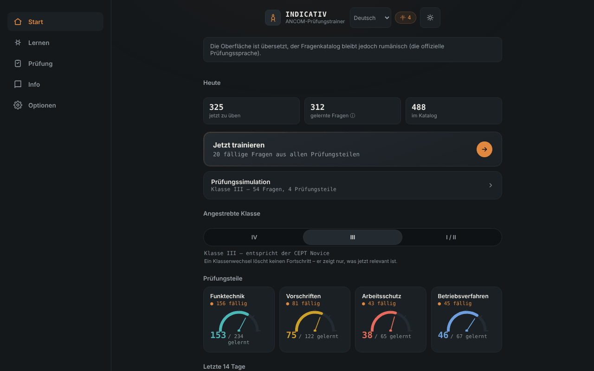

# INDICATIV — Trainer für die ANCOM-Amateurfunkprüfung

[English](README.md) · [Română](README.ro.md) · [Français](README.fr.md) · [Italiano](README.it.md) · [Español](README.es.md) · [Português](README.pt.md) · **Deutsch** · [Magyar](README.hu.md)

**Version:** 2.0.0 · **Zuletzt aktualisiert:** 2026-10-26

Oberflächensprachen: **Română, English, Français, Italiano, Español, Português (PT), Deutsch, Magyar**

Ein Offline-Trainer, inoffiziell, für die ANCOM-Amateurfunkprüfung: verteilte Wiederholung und simulierte Prüfung, in einer einzigen HTML-Datei. Begleiter von [ETER](https://chiuta.github.io/ETER/).

**Online-Anwendung:** https://chiuta.github.io/INDICATIV/

## Was es ist

INDICATIV ist ein persönliches Lernprojekt für künftige Funkamateure in Rumänien. Es enthält eine Bank von 723 Fragen mit vier Antwortmöglichkeiten, aufgeteilt nach den Prüfungsteilen: Funktechnik (469), Vorschriften (122), Betriebsverfahren (67) und Arbeitsschutz (65). Die Anwendung merkt sich lokal, was du falsch beantwortet hast, und zeigt dir diese Fragen öfter.

**Die Anwendung ist kein offizielles ANCOM-Material**, wird nicht von ANCOM erstellt oder gebilligt und hat keinen Rechtswert. Die echte Prüfung kann abweichen (Fragen, Aufbau, aktualisierte Vorschriften).

## Funktionen

Im Code und im Browser geprüft:
- Training mit verteilter Wiederholung (Algorithmus vom Typ SM-2): fällige und neue Fragen erscheinen zuerst; falsch beantwortete kehren in derselben Runde nach einigen Karten zurück. Rundengröße: 10, 20 oder 30 Fragen.
- Wahl der Zielklasse (IV, III, I/II); die Anwendung zeigt die relevanten Prüfungsteile (Klasse IV hat keinen Funktechnik-Teil; bei Klasse III verwendet die Funktechnik nur die Fragen der Stufen A und B).
- Simulierte Prüfung mit dem Aufbau der Prüfungsteile gemäß ANCOM-Beschluss 245/2017 (Fragenzahl und Mindestschwelle je Teil), ohne Rückmeldung zwischendurch, mit dem Ergebnis ADMIS/RESPINS (bestanden/nicht bestanden) und Durchsicht der Fehler.
- „Nur die Fehler wiederholen“, „Schnelle Wiederholung“ (Vorschriften + Verfahren), „Endspurt“, Fortsetzen einer unterbrochenen Runde.
- Fortschrittsanzeige je Prüfungsteil, Serie von Lerntagen und Diagramm der letzten 14 Tage.
- Referenz: phonetisches Alphabet (mit Sprachausgabe, falls der Browser sie anbietet), Q-Gruppen, Abkürzungen, RST-Rapport, Notsignale, Notfrequenzen (orientierend, nicht auf Aktualität geprüft).
- Getrennte lokale Profile, automatisches/helles/dunkles Design, Fortschrittsübersicht, Export/Import des Fortschritts (JSON), Zurücksetzen.
- „Suche in der Fragenbank“ (im Bildschirm Referenz): sucht in Fragetext und Antwortvarianten, ohne Berücksichtigung von Diakritika, und zeigt die richtige Antwort; Ergebnisse auf 30 begrenzt, mit Meldungen für zu kurze oder ergebnislose Suchanfragen.
- Tastenkürzel im Quiz: 1–4 wählen die Antwort, Enter/Leertaste setzen fort.

## Neue Funktionen (v1.1.0, 14. Oktober 2026)

**Hinweis:** Den Prüfungsmodus gab es schon (simulierte Prüfung mit dem Aufbau der Prüfungsteile, ohne Rückmeldung zwischendurch, Ergebnis ADMIS/RESPINS und Durchsicht der Fehler). Er wurde nicht verdoppelt; ich habe ergänzt, was fehlte:

### Optionale Stoppuhr in der simulierten Prüfung
Im Bildschirm „Simulierte Prüfung“ wählst du ein Zeitlimit: **Keines** (Standard), 30, 60 oder 90 Minuten. **Die offizielle Dauer der Prüfung ist in dieser Anwendung nicht festgelegt** (ich habe sie nicht aus einer offiziellen Quelle bestätigt), daher wählst du den Wert selbst. Die Stoppuhr (`role="timer"`) erscheint in der Fragenleiste, wird in den letzten 5 Minuten rot, kündigt für Screenreader bei 10, 5 und 1 Minute an und beruht auf einer Frist (`Date.now`), friert also nicht mit dem Tab im Hintergrund ein. Bei Ablauf endet die Prüfung automatisch: **unbeantwortete Fragen zählen als falsch**, und das Urteil weist darauf hin. Das Abbrechen der Prüfung stoppt die Stoppuhr. Die Auswahl wird im lokalen Profil gespeichert (`settings.examMinutes`).

### Verlauf der simulierten Prüfungen
Der Bildschirm „Simulierte Prüfung“ zeigt die letzten 5 Prüfungen (Datum, Klasse, ADMIS/RESPINS, gegebenenfalls „Zeit abgelaufen“). Die Daten gab es bereits im Profil (`examLog`); jetzt sind sie sichtbar. Der Export/Import des Fortschritts behält sie bei.

### Transparenz und Datensicherung (fff-kit)

Ein Klick (oder Enter) auf die angezeigte Version (`v 1.1.0 · 2026-10-14`) öffnet das Fenster „Transparenz“: die deklarierten Netzwerk-Hosts (0 externe Anfragen), die lokalen Speicherschlüssel mit Größen, die verwendeten APIs, Größe und SHA-256 der Datei (mit einem Prüfwerkzeug für eine heruntergeladene Datei) und die **Datensicherung** der Anwendungsdaten in eine `.fff.json`-Datei (optional mit Passwort verschlüsselt, AES-GCM 256 / PBKDF2; das Passwort ist nicht wiederherstellbar), Import mit Bestätigung und Löschen der Anwendungsdaten. Das Kit (`fff-kit`, Module: core, label, bundle) ist in `index.html` eingefügt, stellt keine Netzwerkanfragen und ändert keine vorhandenen Daten; ohne es funktioniert die Anwendung genauso. Die Sicherung des Kits umfasst die `localStorage`-Schlüssel der INDICATIV-Profile (Fortschritt, Einstellungen, Verlauf); der eigene Export der Anwendung („Einstellungen“ → Fortschritt exportieren) bleibt verfügbar. Die Texte des Kits liegen in 8 Sprachen vor (ro, en, fr, it, es, pt, hu, de); **die Übersetzungen fr/it/es/pt/hu/de sind automatisch und nicht von Muttersprachlern geprüft**. Die Oberfläche der Anwendung selbst bleibt auf Rumänisch.

## Bedienungsanleitung

1. Öffne die Seite und lies die Begrüßung.
2. Wähle auf dem Bildschirm „Start“ die Zielklasse (IV, III oder I/II).
3. Drücke „Jetzt trainieren“ oder wähle einen Prüfungsteil unter „Lernen“.
4. Beantworte die Fragen; drücke nach jeder Antwort auf „Weiter“.
5. Unter „Prüfung“ startest du eine vollständige Simulation für die gewählte Klasse.
6. In den „Einstellungen“ exportierst du den Fortschritt (JSON-Datei) als Sicherung und kannst ihn später importieren.

## Datenschutz und Netzwerk

- **Speicherung:** Der Fortschritt (Wiederholungen, Statistiken, Einstellungen, Profile) wird im `localStorage` des Browsers gespeichert, nur auf deinem Gerät, mit Fehlerbehandlung (ist der Speicher blockiert, funktioniert die Anwendung ohne Speichern). Es werden weder Cookies noch `sessionStorage` oder IndexedDB verwendet.
- **Netzwerk:** Die Anwendung führt keinerlei Netzwerkaufrufe aus (kein `fetch`, keine externen Ressourcen, keine externen Hosts). Die Seite hat eine restriktive CSP-Richtlinie (`default-src 'none'`). Der einzige Link ist ein `mailto:` an den Autor, der sich nur öffnet, wenn du ihn drückst.
- **Berechtigungen:** Es werden keine Berechtigungen angefordert (weder Mikrofon noch Standort noch Kamera). Die Sprachausgabe des phonetischen Alphabets nutzt die Sprachsynthese des Browsers/Systems; bei einigen Browsern können die Stimmen online vom Browserhersteller bereitgestellt werden, außerhalb der Kontrolle der Anwendung.
- Der Fortschrittsexport ist eine lokal heruntergeladene Datei; der Import liest eine von dir gewählte Datei und validiert sie, bevor er sie verwendet.

## Grenzen und Hinweise

- **Übersetzungen der Fragen (v1.3.1):** alle 723 Fragen (Aufgabentext und 4 Optionen) gibt es auch auf en, fr, it, es, pt, de, hu, angezeigt unter dem offiziellen rumänischen Text (Schalter in den Einstellungen; die Suche umfasst sie ebenfalls). Der rumänische Text bleibt der offizielle Prüfungstext; die Übersetzungen sind eine **Lernhilfe**, automatisch, nicht von Muttersprachlern geprüft und in der App als inoffiziell gekennzeichnet. Die Regelungsinhalte (ANCOM-Beschluss 245/2017, Verfahren) und die Fragen zu Arbeitsschutz / Erster Hilfe (z. B. Stromschlag) sind getreue Übersetzungen ohne zusätzliche Ratschläge und **müssen fachlich bzw. juristisch geprüft werden**.
- **Inoffiziell:** Es ist kein ANCOM-Material; die geltenden offiziellen Texte findest du bei ANCOM (ancom.ro, Bereich Funkamateure). Der ANCOM-Beschluss 245/2017 (konsolidierter Text vom 31.03.2022, geändert durch Beschluss 139/2022) ist die Grundlage der Vorschriften, laut der im Oktober 2026 eingesehenen ANCOM-Seite.
- **Die Fragenbank:** Sie wurde teilweise geprüft. Die numerischen Funktechnik-Antworten (über 150 Fragen) wurden mit einem Skript neu berechnet, und es wurden keine falschen Antworten gefunden; die übrigen Fragen (konzeptionelle, Vorschriften, Verfahren, Arbeitsschutz) wurden nicht einzeln bestätigt. Einige Antworten spiegeln die Formulierung des Lernmaterials wider und können veraltet sein (zum Beispiel die Farben der Phasenleiter, die genauen 70-cm-Bänder, die Aufbewahrungsfrist des Stationstagebuchs). Wenn du einen Fehler findest, schreibe dem Autor (der Fragencode steht im Etikett über der Frage).
- **Herkunft und Rechte an den Fragen:** Die Kapitel I–III der Funktechnik stammen laut Autor aus der von ANCOM veröffentlichten „Themenliste“; die Kapitel IV–IX aus Community-Quellen (das Projekt SimEx), für die der Autor die GNU-GPL-Lizenz nennt; der Rest aus Lernmaterialien, die ANCOM Iași und der Funkamateur-Gemeinschaft zugeschrieben werden. Der rechtliche Status dieser Texte wurde nicht geklärt; deshalb erklärt das Repository keine Lizenz für den Inhalt (siehe unten).
- Die Antwortvarianten werden nicht gemischt (die Reihenfolge aus dem offiziellen Material bleibt erhalten), weil sich manche Fragen auf „die vorherigen Antworten“ beziehen.
- Die Prüfungssimulation ist didaktisch: Das Ergebnis ADMIS/RESPINS sagt das Ergebnis der echten Prüfung nicht voraus.
- Telegrafie ist kein Prüfungsteil in der Prüfungsstruktur des Beschlusses und wird hier nicht trainiert.

## Lokal / offline ausführen

Lade `index.html` herunter und öffne die Datei im Browser; sie funktioniert vollständig ohne Internet.

## Verlauf / Changelog

### 1.3.9 — 2026-10-23

- Fix: Die Lernserie fiel auf 1 zurück, wenn man in der ersten Stunde nach der Umstellung auf Sommerzeit lernte („gestern“ wurde als „jetzt − 24 h“ berechnet); jetzt wird der vorherige Kalendertag verwendet. Neuer Regressionstest.

### 1.3.8 — 2026-10-23

- Dialoge: Die nativen Boxen `alert`/`confirm`/`prompt` wurden durch barrierefreie, übersetzte `FFF.dialog`-Dialoge ersetzt (Tastatur, Fokusfalle, Esc) – mit unverändertem Verhalten (fff-kit 1.2.0).

### 1.3.6 — 2026-10-22

fff-kit 1.1.4: Touch-Ziele und Mindestschriftgröße. Touch-Ziele/Text in der App korrigiert.

### 1.3.5 — 2026-10-22

fff-kit 1.1.2: PBKDF2 mit 600.000 Iterationen, Schutz vor Clickjacking.
### 1.3.4 — 2026-10-22
- Offline: Ein echter Service Worker und ein Web-App-Manifest mit Symbolen wurden hinzugefügt (installierbar; der Trainer öffnet sich nach dem ersten Besuch ohne Verbindung). Das alte Inline-Manifest (data:) wurde entfernt.
- Die blockierenden `alert()`-Meldungen beim Fortschrittsimport und das Browser-`prompt()` zum Hinzufügen eines Profils wurden durch eine nicht-modale Benachrichtigung und einen Dialog in der App ersetzt (in alle 8 Sprachen übersetzt).

### 1.3.3 — 2026-10-22
- Die ausgeblendeten Vorlagen „0 von 0 richtig“ und „Du hast alle Prüfungsteile bestanden“ stehen jetzt im Sprachwörterbuch (8 Sprachen).

### 1.3.2 — 2026-10-22
- Übersetzungskorrektur: Das Fortsetzen-Banner, die Unterbeschriftungen für Training und Wiederholung und die Schaltfläche „Fehler wiederholen“ der Prüfung zeigen in anderen Sprachen keinen rumänischen Text mehr.

- 1.3.1 — 2026-10-19: Übersetzungshilfe für den gesamten Fragenkatalog (723 Fragen) in 7 Sprachen, angezeigt unter dem offiziellen rumänischen Text; auch Kategorien, Fächer und die 19 Formelhinweise sind übersetzt.
- 1.2.0 — 2026-10-19: Nach der Antwort im Training ein Link „in ETER lesen“ (neuer Tab) zum Abschnitt, der das Thema der Frage behandelt (~136 von 723 Fragen); Link zu Alphabeten bei der phonetischen Referenz. Nur Links, keine Netzwerkanfragen.
- 1.1.0 — 2026-10-14: optionale Stoppuhr in der simulierten Prüfung (mit automatischem Abschluss, übrige Fragen als falsch gezählt); Verlauf der letzten 5 Prüfungen; Kit fff-kit (Transparenz + Datensicherung). Die Fragenbank hat sich nicht geändert.

- 1.0.0 — 2026-10-12: Die Version und das Datum der letzten Aktualisierung werden in der Anwendung angezeigt
- Die nach der Antwort im Training angezeigten Formeln decken jetzt 100 der 216 numerischen Funktechnik-Fragen ab (zuvor 29): Reihen- und Parallelschaltung von Widerständen, Glühlampe mit Vorwiderstand, Induktivität auf Ferritring (AL), Bandbreite und Modulationsindex bei NBFM, Leistung an der Last, dBd-Gewinnverhältnis, SI-Präfixe und Frequenz–Periode. Jede Familie wurde mit einem Skript numerisch gegen die richtige Antwort aller passenden Fragen geprüft (56 berechenbare Fragen, 0 Abweichungen).
- Nach jeder Antwort im Training werden jetzt die richtige Antwort, das Thema der Frage und, falls vorhanden, die nützliche Formel angezeigt (nicht nur „Richtig.“). Einzelerklärungen für alle 723 Fragen gibt es in der Bank noch nicht.
- Suche in der Fragenbank hinzugefügt (Referenz); der Titel der Anwendung ist jetzt `<h1>`, und der Bildschirm Referenz verwendet eine korrekte Überschriftenhierarchie; Druckstil (ohne Navigationsleiste); CSP: `script-src` per SHA-256-Hash, ohne `'unsafe-inline'`.
- Die Diakritika mit Cedille (ş, ţ) in der Oberfläche und in der Bank wurden durch die korrekte Form mit Komma (ș, ț) ersetzt.
- Die Navigationsleiste auf dem Handy folgt jetzt dem Design (sie war immer dunkel, mit unzureichendem Kontrast im hellen Design).
- Semantische Struktur (`header`, `main`, `nav`) für die Barrierefreiheit; axe-core: 0 Verstöße bei 1280 und 360 px.
- Die Vorschriften konnten am 11.10.2026 nicht unabhängig erneut geprüft werden; der Text unter „Grenzen und Hinweise“ bleibt der vom Oktober 2026, mit Verweis auf ANCOM.

## Lizenz

Die Lizenz ist noch nicht erklärt. Wegen der Herkunft der Fragen (einschließlich Community-Materialien, die unter GNU GPL genannt werden) hängt die Wahl einer Lizenz für den Inhalt von der Klärung der Rechte ab.

## Autor

Alexio — Alexandru-Ionuț Chiuță, Kontakt: alexio@trom.tf

## Zusammenfassung

INDICATIV ist ein Trainer in einer einzigen Datei, offline und inoffiziell (auf Rumänisch), für die ANCOM-Amateurfunkprüfung: 723 Multiple-Choice-Fragen, verteilte Wiederholung nach SM-2 und eine simulierte Prüfung nach dem Aufbau des ANCOM-Beschlusses 245/2017. Der Fortschritt wird nur im `localStorage` des Browsers gespeichert; die Anwendung stellt keine Netzwerkanfragen (strikte CSP). Es ist kein offizielles ANCOM-Material; die Lizenzierung der Fragentexte ist ungeklärt, daher ist noch keine Lizenz erklärt.
