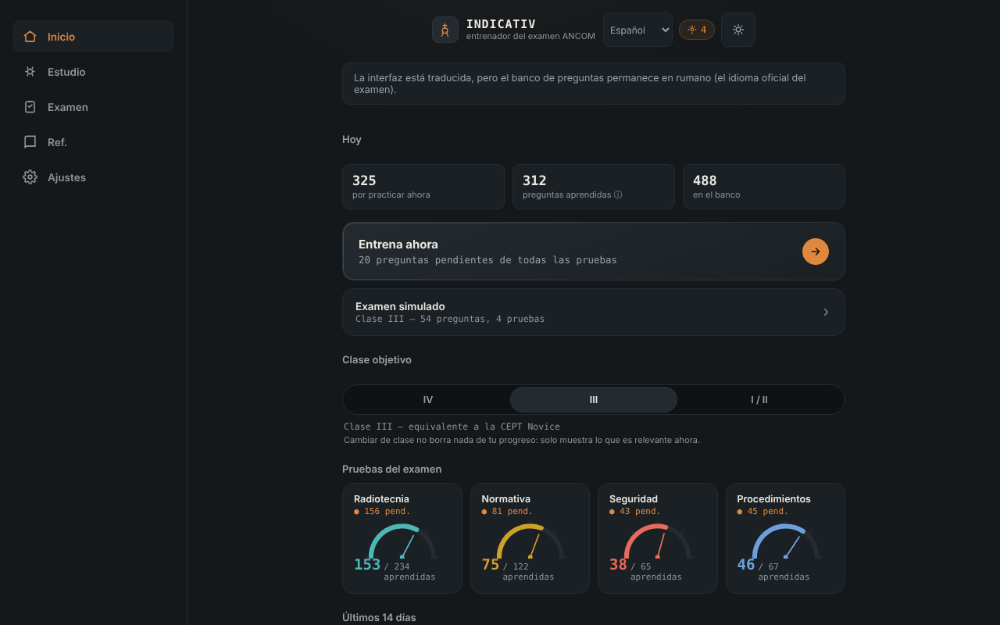

# INDICATIV — entrenador para el examen ANCOM de radioaficionado

[English](README.md) · [Română](README.ro.md) · [Français](README.fr.md) · [Italiano](README.it.md) · **Español** · [Português](README.pt.md) · [Deutsch](README.de.md) · [Magyar](README.hu.md)

**Versión:** 1.3.1 · **Última actualización:** 2026-10-19

Idiomas de la interfaz: **Română, English, Français, Italiano, Español, Português (PT), Deutsch, Magyar**

Entrenador sin conexión, no oficial, para el examen ANCOM de radioaficionado: repetición espaciada y examen simulado, en un único archivo HTML. Complemento de [ETER](https://chiuta.github.io/ETER/).

**Aplicación en línea:** https://chiuta.github.io/INDICATIV/

## Qué es

INDICATIV es un proyecto de estudio personal para los futuros radioaficionados de Rumanía. Contiene un banco de 723 preguntas con cuatro opciones de respuesta, repartidas según las pruebas del examen: radiotecnia (469), reglamentación (122), procedimientos de operación (67) y protección laboral (65). La aplicación recuerda localmente lo que has fallado y te muestra esas preguntas con más frecuencia.

**La aplicación no es material oficial de ANCOM**, no está realizada ni avalada por ANCOM y no tiene valor jurídico. El examen real puede diferir (preguntas, estructura, normativa actualizada).

## Funciones

Verificado en el código y en el navegador:
- Entrenamiento con repetición espaciada (algoritmo de tipo SM-2): las preguntas vencidas y las nuevas aparecen primero; las falladas vuelven en la misma ronda tras unas pocas tarjetas. Tamaño de la ronda: 10, 20 o 30 preguntas.
- Elección de la clase objetivo (IV, III, I/II); la aplicación muestra las pruebas pertinentes (la clase IV no tiene prueba de radiotecnia; en la clase III la radiotecnia usa solo las preguntas de nivel A y B).
- Examen simulado con la estructura de las pruebas de la Decisión ANCOM 245/2017 (número de preguntas y umbral mínimo por prueba), sin retroalimentación durante la prueba, con resultado ADMIS/RESPINS (admitido/rechazado) y revisión de los errores.
- «Revisar solo los errores», «Repaso rápido» (reglamentación + procedimientos), «Sprint final», reanudación de una ronda interrumpida.
- Indicador de progreso por prueba, racha de días de estudio y gráfico de los últimos 14 días.
- Referencia: alfabeto fonético (con lectura en voz alta, si el navegador la ofrece), códigos Q, abreviaturas, informe RST, señales de socorro, frecuencias de emergencia (orientativo, sin verificar que esté al día).
- Perfiles locales separados, tema automático/claro/oscuro, resumen del progreso, exportación/importación del progreso (JSON), restablecimiento.
- «Búsqueda en el banco de preguntas» (en la pantalla Referencia): busca en el enunciado y en las opciones, sin tener en cuenta los signos diacríticos, y muestra la respuesta correcta; resultados limitados a 30, con mensajes para consultas demasiado cortas o sin resultados.
- Atajos de teclado en el cuestionario: 1–4 eligen la opción, Intro/Espacio continúan.

## Novedades (v1.1.0, 14 de octubre de 2026)

**Nota:** el modo examen ya existía (examen simulado con la estructura de las pruebas, sin retroalimentación durante la prueba, resultado ADMIS/RESPINS y revisión de errores). No se duplicó; añadí lo que faltaba:

### Cronómetro opcional en el examen simulado
En la pantalla «Examen simulado» eliges un límite de tiempo: **Ninguno** (predeterminado), 30, 60 o 90 minutos. **La duración oficial del examen no está establecida en esta aplicación** (no la he confirmado en una fuente oficial), por lo que el valor lo eliges tú. El cronómetro (`role="timer"`) aparece en la barra de la pregunta, se pone rojo en los últimos 5 minutos, avisa a los 10, 5 y 1 minuto a los lectores de pantalla y se basa en un plazo (`Date.now`), por lo que no se congela con la pestaña en segundo plano. Al expirar, el examen termina automáticamente: **las preguntas sin responder se cuentan como falladas**, y el veredicto lo indica. Abandonar el examen detiene el cronómetro. La elección se conserva en el perfil local (`settings.examMinutes`).

### Historial de exámenes simulados
La pantalla «Examen simulado» muestra los últimos 5 exámenes (fecha, clase, ADMIS/RESPINS, «tiempo agotado», según corresponda). Los datos ya existían en el perfil (`examLog`); ahora son visibles. La exportación/importación del progreso los conserva.

### Transparencia y copia de seguridad (fff-kit)

Un clic (o Intro) en la versión mostrada (`v 1.1.0 · 2026-10-14`) abre la ventana «Transparencia»: los hosts de red declarados (0 solicitudes externas), las claves de almacenamiento local con sus tamaños, las API utilizadas, el tamaño y el SHA-256 del archivo (con un verificador para un archivo descargado) y la **copia de seguridad** de los datos de la aplicación en un archivo `.fff.json` (opcionalmente cifrado con contraseña, AES-GCM 256 / PBKDF2; la contraseña no se puede recuperar), la importación con confirmación y el borrado de los datos de la aplicación. El kit (`fff-kit`, módulos: core, label, bundle) está pegado en `index.html`, no hace solicitudes de red y no modifica los datos existentes; sin él la aplicación funciona igual. La copia de seguridad del kit abarca las claves `localStorage` de los perfiles de INDICATIV (progreso, ajustes, historial); la exportación propia de la aplicación («Ajustes» → exportar progreso) sigue disponible. Los textos del kit están en 8 idiomas (ro, en, fr, it, es, pt, hu, de); **las traducciones fr/it/es/pt/hu/de son automáticas y no están verificadas por hablantes nativos**. La interfaz de la propia aplicación sigue en rumano.

## Manual de uso

1. Abre la página y lee el mensaje de bienvenida.
2. En la pantalla «Inicio» elige la clase objetivo (IV, III o I/II).
3. Pulsa «Entrénate ahora» o elige una prueba en «Estudio».
4. Responde a las preguntas; tras cada respuesta pulsa «Continuar».
5. Desde «Examen» inicias una simulación completa para la clase elegida.
6. En «Ajustes» exportas el progreso (archivo JSON) como copia de seguridad y puedes importarlo más tarde.

## Privacidad y red

- **Almacenamiento:** el progreso (repeticiones, estadísticas, ajustes, perfiles) se guarda en el `localStorage` del navegador, solo en tu dispositivo, con tratamiento de errores (si el almacenamiento está bloqueado, la aplicación funciona sin guardar). No usa cookies, `sessionStorage` ni IndexedDB.
- **Red:** la aplicación no hace ninguna llamada de red (sin `fetch`, sin recursos externos, sin hosts externos). La página tiene una política CSP restrictiva (`default-src 'none'`). El único enlace es un `mailto:` al autor, que se abre solo si lo pulsas.
- **Permisos:** no solicita permisos (ni micrófono, ni ubicación, ni cámara). La lectura en voz alta del alfabeto fonético usa la síntesis de voz del navegador/sistema; en algunos navegadores las voces pueden ser proporcionadas en línea por el fabricante del navegador, fuera del control de la aplicación.
- La exportación del progreso es un archivo descargado localmente; la importación lee un archivo elegido por ti y lo valida antes de usarlo.

## Límites y advertencias

- **Traducciones de las preguntas (v1.3.1):** las 723 preguntas (enunciado y 4 opciones) están disponibles también en en, fr, it, es, pt, de, hu, mostradas bajo el texto oficial rumano (interruptor en Ajustes; la búsqueda también las abarca). El texto rumano sigue siendo el texto oficial del examen; las traducciones son una **ayuda de estudio**, automáticas, no verificadas por hablantes nativos y marcadas en la aplicación como no oficiales. El contenido normativo (Decisión ANCOM 245/2017, procedimientos) y las preguntas de seguridad laboral / primeros auxilios (p. ej. electrocución) son traducciones fieles sin consejos añadidos y **requieren revisión especializada o jurídica**.
- **No oficial:** no es material de ANCOM; los textos oficiales en vigor se encuentran en ANCOM (ancom.ro, sección Radioaficionados). La Decisión ANCOM 245/2017 (texto consolidado a 31.03.2022, modificada por la Decisión 139/2022) es la base de la normativa, según la página de ANCOM consultada en octubre de 2026.
- **El banco de preguntas:** se ha verificado parcialmente. Las respuestas numéricas de radiotecnia (más de 150 preguntas) se recalcularon con un script y no se encontraron respuestas erróneas; el resto de las preguntas (conceptuales, de reglamentación, de procedimientos, de protección laboral) no se confirmaron individualmente. Algunas respuestas reflejan la redacción del material de estudio y pueden estar desfasadas (por ejemplo los colores de los conductores de fase, las bandas exactas de 70 cm, el período de conservación del diario de estación). Si encuentras un error, escribe al autor (el código de la pregunta aparece en la etiqueta situada encima).
- **Procedencia y derechos sobre las preguntas:** los capítulos I–III de radiotecnia proceden, según el autor, de la «Lista de temas» publicada por ANCOM; los capítulos IV–IX de fuentes comunitarias (el proyecto SimEx), para las que el autor menciona la licencia GNU GPL; el resto de materiales de estudio atribuidos a ANCOM Iași y a la comunidad de radioaficionados. El estatus jurídico de estos textos no se ha aclarado; por eso el repositorio no declara una licencia para el contenido (véase más abajo).
- Las opciones de respuesta no se mezclan (se mantiene el orden del material oficial), porque algunas preguntas se refieren a «las respuestas anteriores».
- La simulación de examen es didáctica: el resultado ADMIS/RESPINS no anticipa el resultado en el examen real.
- La telegrafía no es una prueba en la estructura del examen de la decisión y aquí no se entrena.

## Ejecución local / sin conexión

Descarga `index.html` y ábrelo en el navegador; funciona completamente sin internet.

## Historial / Changelog
- 1.3.1 — 2026-10-19: ayuda de traducción para todo el banco de preguntas (723 preguntas) en 7 idiomas, mostrada bajo el texto oficial rumano; también se traducen las categorías, las materias y las 19 pistas de fórmulas.
- 1.2.0 — 2026-10-19: tras la respuesta, en el entrenamiento, enlace «leer en ETER» (pestaña nueva) a la sección que cubre el tema de la pregunta (~136 de 723 preguntas); enlace a Alfabetos en la referencia fonética. Solo enlaces, sin solicitudes de red.
- 1.1.0 — 2026-10-14: cronómetro opcional en el examen simulado (con cierre automático y preguntas restantes contadas como falladas); historial de los últimos 5 exámenes; kit fff-kit (Transparencia + copia de seguridad). El banco de preguntas no cambió.

- 1.0.0 — 2026-10-12: la versión y la fecha de la última actualización se muestran en la aplicación
- Las fórmulas mostradas tras la respuesta en el entrenamiento cubren ahora 100 de las 216 preguntas numéricas de radiotecnia (frente a 29): resistencias en serie y en paralelo, bombilla con resistencia en serie, inductancia en toroide de ferrita (AL), ancho de banda e índice de modulación NBFM, potencia en la carga, relación de ganancia dBd, prefijos SI y frecuencia–período. Cada familia se verificó numéricamente con un script frente a la respuesta correcta de todas las preguntas correspondientes (56 preguntas calculables, 0 discrepancias).
- Tras cada respuesta en el entrenamiento se muestran ahora la respuesta correcta, el tema de la pregunta y, cuando existe, la fórmula útil (no solo «Correcto.»). Aún no existen explicaciones individuales para las 723 preguntas en el banco.
- Añadida la búsqueda en el banco de preguntas (Referencia); el título de la aplicación es ahora `<h1>` y la pantalla Referencia usa una jerarquía de títulos correcta; estilo de impresión (sin barra de navegación); CSP: `script-src` mediante hash SHA-256, sin `'unsafe-inline'`.
- Los signos diacríticos con cedilla (ş, ţ) de la interfaz y del banco se sustituyeron por la forma correcta con coma (ș, ț).
- La barra de navegación en el móvil sigue ahora el tema (era siempre oscura, con contraste insuficiente en el tema claro).
- Estructura semántica (`header`, `main`, `nav`) para la accesibilidad; axe-core: 0 infracciones a 1280 y 360 px.
- La normativa no pudo reverificarse de forma independiente el 11.10.2026; el texto de «Límites y advertencias» sigue siendo el de octubre de 2026, con remisión a ANCOM.

## Licencia

La licencia aún no está declarada. Debido a la procedencia de las preguntas (incluidos materiales comunitarios mencionados bajo GNU GPL), la elección de una licencia para el contenido depende de aclarar los derechos.

## Autor

Alexio — Alexandru-Ionuț Chiuță, contacto: alexio@trom.tf

## Resumen

INDICATIV es un entrenador de un solo archivo, sin conexión y no oficial (en rumano) para el examen ANCOM de radioaficionado: 723 preguntas de opción múltiple, repetición espaciada SM-2 y un examen simulado que sigue la estructura de la Decisión ANCOM 245/2017. El progreso se almacena solo en el `localStorage` del navegador; la aplicación no hace solicitudes de red (CSP estricta). No es material oficial de ANCOM; la licencia de los textos de las preguntas no está resuelta, por lo que aún no se declara ninguna licencia.
