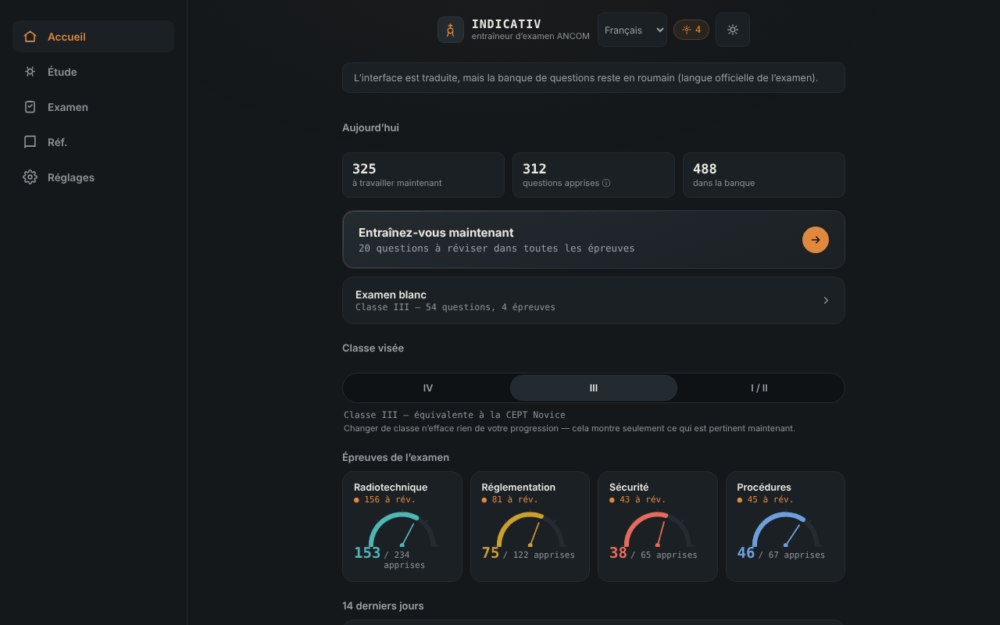

# INDICATIV — entraîneur pour l'examen ANCOM de radioamateur

[English](README.md) · [Română](README.ro.md) · **Français** · [Italiano](README.it.md) · [Español](README.es.md) · [Português](README.pt.md) · [Deutsch](README.de.md) · [Magyar](README.hu.md)

**Version :** 1.3.0 · **Dernière mise à jour :** 2026-10-19

Langues de l'interface : **Română, English, Français, Italiano, Español, Português (PT), Deutsch, Magyar**

Entraîneur hors ligne, non officiel, pour l'examen ANCOM de radioamateur : répétition espacée et examen simulé, dans un seul fichier HTML. Compagnon d'[ETER](https://chiuta.github.io/ETER/).

**Application en ligne :** https://chiuta.github.io/INDICATIV/

## De quoi s'agit-il

INDICATIV est un projet d'étude personnel pour les futurs radioamateurs de Roumanie. Il contient une banque de 723 questions à quatre choix de réponse, réparties selon les épreuves de l'examen : radiotechnique (469), réglementation (122), procédures d'exploitation (67) et protection du travail (65). L'application retient localement ce que vous avez raté et vous montre ces questions plus souvent.

**L'application n'est pas un document officiel de l'ANCOM**, n'est ni réalisée ni approuvée par l'ANCOM et n'a aucune valeur juridique. L'examen réel peut différer (questions, structure, réglementation mise à jour).

## Fonctionnalités

Vérifié dans le code et dans le navigateur :
- Entraînement avec répétition espacée (algorithme de type SM-2) : les questions échues et les nouvelles apparaissent en premier ; celles qui ont été ratées reviennent dans la même série après quelques cartes. Taille de la série : 10, 20 ou 30 questions.
- Choix de la classe visée (IV, III, I/II) ; l'application montre les épreuves pertinentes (la classe IV n'a pas d'épreuve de radiotechnique ; pour la classe III, la radiotechnique n'utilise que les questions de niveau A et B).
- Examen simulé avec la structure des épreuves de la Décision ANCOM 245/2017 (nombre de questions et seuil minimal par épreuve), sans retour en cours de route, avec un résultat ADMIS/RESPINS (admis/refusé) et la révision des erreurs.
- « Réviser seulement les erreurs », « Révision rapide » (réglementation + procédures), « Sprint final », reprise d'une série interrompue.
- Indicateur de progression par épreuve, série de jours d'étude et graphique des 14 derniers jours.
- Référence : alphabet phonétique (avec lecture vocale, si le navigateur la propose), codes Q, abréviations, rapport RST, signaux de détresse, fréquences d'urgence (indicatif, non vérifié à jour).
- Profils locaux séparés, thème automatique/clair/sombre, résumé de progression, export/import de la progression (JSON), réinitialisation.
- « Recherche dans la banque de questions » (dans l'écran Référence) : cherche dans l'énoncé et dans les choix, sans tenir compte des diacritiques, et affiche la bonne réponse ; résultats limités à 30, avec des messages pour les requêtes trop courtes ou sans résultat.
- Raccourcis clavier dans le quiz : 1–4 choisissent la réponse, Entrée/Espace continuent.

## Nouveautés (v1.1.0, 14 octobre 2026)

**Note :** le mode examen existait déjà (examen simulé avec la structure des épreuves, sans retour en cours de route, résultat ADMIS/RESPINS et révision des erreurs). Il n'a pas été dupliqué ; j'ai ajouté ce qui manquait :

### Chronomètre facultatif dans l'examen simulé
Dans l'écran « Examen simulé », vous choisissez une limite de temps : **Aucune** (par défaut), 30, 60 ou 90 minutes. **La durée officielle de l'examen n'est pas établie dans cette application** (je ne l'ai pas confirmée à partir d'une source officielle), c'est donc vous qui choisissez la valeur. Le chronomètre (`role="timer"`) apparaît dans la barre de la question, devient rouge dans les 5 dernières minutes, annonce à 10, 5 et 1 minute pour les lecteurs d'écran et repose sur une échéance (`Date.now`), de sorte qu'il ne se fige pas lorsque l'onglet est en arrière-plan. À l'expiration, l'examen se termine automatiquement : **les questions restées sans réponse sont comptées comme fausses**, et le verdict le précise. Abandonner l'examen arrête le chronomètre. Le choix est conservé dans le profil local (`settings.examMinutes`).

### Historique des examens simulés
L'écran « Examen simulé » affiche les 5 derniers examens (date, classe, ADMIS/RESPINS, « temps expiré », selon le cas). Les données existaient déjà dans le profil (`examLog`) ; elles sont maintenant visibles. L'export/import de la progression les conserve.

### Transparence et sauvegarde (fff-kit)

Un clic (ou Entrée) sur la version affichée (`v 1.1.0 · 2026-10-14`) ouvre la fenêtre « Transparence » : les hôtes réseau déclarés (0 requête externe), les clés de stockage local avec leurs tailles, les API utilisées, la taille et le SHA-256 du fichier (avec un vérificateur pour un fichier téléchargé) et la **sauvegarde** des données de l'application dans un fichier `.fff.json` (éventuellement chiffré par mot de passe, AES-GCM 256 / PBKDF2 ; le mot de passe ne peut pas être récupéré), l'import avec confirmation et la suppression des données de l'application. Le kit (`fff-kit`, modules : core, label, bundle) est collé dans `index.html`, ne fait aucune requête réseau et ne modifie pas les données existantes ; sans lui, l'application fonctionne de la même façon. La sauvegarde du kit couvre les clés `localStorage` des profils INDICATIV (progression, paramètres, historique) ; l'export propre de l'application (« Paramètres » → export de la progression) reste disponible. Les textes du kit sont en 8 langues (ro, en, fr, it, es, pt, hu, de) ; **les traductions fr/it/es/pt/hu/de sont automatiques et non vérifiées par des locuteurs natifs**. L'interface de l'application elle-même reste en roumain.

## Mode d'emploi

1. Ouvrez la page et lisez le message d'accueil.
2. Sur l'écran « Accueil », choisissez la classe visée (IV, III ou I/II).
3. Appuyez sur « Entraîne-toi maintenant » ou choisissez une épreuve dans « Étude ».
4. Répondez aux questions ; après chaque réponse, appuyez sur « Continuer ».
5. Depuis « Examen », vous lancez une simulation complète pour la classe choisie.
6. Dans « Paramètres », vous exportez la progression (fichier JSON) comme sauvegarde et pouvez l'importer plus tard.

## Confidentialité et réseau

- **Stockage :** la progression (répétitions, statistiques, paramètres, profils) est enregistrée dans le `localStorage` du navigateur, uniquement sur votre appareil, avec gestion des erreurs (si le stockage est bloqué, l'application fonctionne sans enregistrement). Elle n'utilise ni cookies, ni `sessionStorage`, ni IndexedDB.
- **Réseau :** l'application ne fait aucun appel réseau (ni `fetch`, ni ressources externes, ni hôtes externes). La page a une politique CSP restrictive (`default-src 'none'`). Le seul lien est un `mailto:` vers l'auteur, qui ne s'ouvre que si vous appuyez dessus.
- **Permissions :** elle ne demande aucune permission (ni microphone, ni localisation, ni caméra). La lecture vocale de l'alphabet phonétique utilise la synthèse vocale du navigateur/système ; dans certains navigateurs, les voix peuvent être fournies en ligne par l'éditeur du navigateur, hors du contrôle de l'application.
- L'export de la progression est un fichier téléchargé localement ; l'import lit un fichier choisi par vous et le valide avant de l'utiliser.

## Limites et avertissements

- **Non officiel :** ce n'est pas un document de l'ANCOM ; les textes officiels en vigueur se trouvent auprès de l'ANCOM (ancom.ro, rubrique Radioamateurs). La Décision ANCOM 245/2017 (texte consolidé au 31.03.2022, modifiée par la Décision 139/2022) est la base de la réglementation, d'après la page de l'ANCOM consultée en octobre 2026.
- **La banque de questions :** elle a été vérifiée partiellement. Les réponses numériques de radiotechnique (plus de 150 questions) ont été recalculées avec un script et aucune réponse erronée n'a été trouvée ; les autres questions (conceptuelles, de réglementation, de procédures, de protection du travail) n'ont pas été confirmées individuellement. Certaines réponses reflètent la formulation du matériel d'étude et peuvent être dépassées (par exemple les couleurs des conducteurs de phase, les bandes exactes de 70 cm, la durée de conservation du journal). Si vous trouvez une erreur, écrivez à l'auteur (le code de la question apparaît dans l'étiquette au-dessus d'elle).
- **Provenance et droits sur les questions :** les chapitres I–III de radiotechnique proviennent, selon l'auteur, de la « Liste de sujets » publiée par l'ANCOM ; les chapitres IV–IX de sources communautaires (le projet SimEx), pour lesquelles l'auteur mentionne la licence GNU GPL ; le reste de matériels d'étude attribués à l'ANCOM Iași et à la communauté des radioamateurs. Le statut juridique de ces textes n'a pas été clarifié ; c'est pourquoi le dépôt ne déclare aucune licence pour le contenu (voir plus bas).
- Les choix de réponse ne sont pas mélangés (l'ordre du matériel officiel est conservé), car certaines questions font référence aux « réponses précédentes ».
- La simulation d'examen est didactique : le résultat ADMIS/RESPINS ne préjuge pas du résultat à l'examen réel.
- La télégraphie n'est pas une épreuve dans la structure de l'examen de la décision et n'est pas entraînée ici.

## Exécution en local / hors ligne

Téléchargez `index.html` et ouvrez-le dans le navigateur ; il fonctionne entièrement sans internet.

## Historique / Changelog
- 1.2.0 — 2026-10-19 : après une réponse, à l'entraînement, lien « lire dans ETER » (nouvel onglet) vers la section qui couvre le sujet de la question (~136 des 723 questions) ; lien vers Alphabets à la référence phonétique. Uniquement des liens, aucune requête réseau.
- 1.1.0 — 2026-10-14 : chronomètre facultatif dans l'examen simulé (avec clôture automatique et questions restantes comptées comme fausses) ; historique des 5 derniers examens ; kit fff-kit (Transparence + sauvegarde). La banque de questions n'a pas changé.

- 1.0.0 — 2026-10-12 : la version et la date de dernière mise à jour sont affichées dans l'application
- Les formules affichées après une réponse à l'entraînement couvrent désormais 100 des 216 questions numériques de radiotechnique (contre 29) : résistances en série et en parallèle, ampoule avec résistance série, inductance sur tore de ferrite (AL), largeur de bande et indice de modulation NBFM, puissance sur charge, rapport de gain dBd, préfixes SI et fréquence–période. Chaque famille a été vérifiée numériquement avec un script par rapport à la bonne réponse de toutes les questions correspondantes (56 questions calculables, 0 écart).
- Après chaque réponse à l'entraînement, s'affichent désormais la bonne réponse, le sujet de la question et, lorsqu'elle existe, la formule utile (et non plus seulement « Correct. »). Des explications individuelles pour les 723 questions n'existent pas encore dans la banque.
- Ajout de la recherche dans la banque de questions (Référence) ; le titre de l'application est désormais `<h1>`, et l'écran Référence utilise une hiérarchie de titres correcte ; style d'impression (sans barre de navigation) ; CSP : `script-src` par hachage SHA-256, sans `'unsafe-inline'`.
- Les diacritiques à cédille (ş, ţ) de l'interface et de la banque ont été remplacés par la forme correcte à virgule (ș, ț).
- La barre de navigation sur mobile suit désormais le thème (elle était toujours sombre, avec un contraste insuffisant dans le thème clair).
- Structure sémantique (`header`, `main`, `nav`) pour l'accessibilité ; axe-core : 0 violation à 1280 et 360 px.
- La réglementation n'a pas pu être revérifiée de façon indépendante au 11.10.2026 ; le texte de « Limites et avertissements » reste celui d'octobre 2026, avec renvoi à l'ANCOM.

## Licence

La licence n'est pas encore déclarée. En raison de la provenance des questions (y compris des matériels communautaires mentionnés sous GNU GPL), le choix d'une licence pour le contenu dépend de la clarification des droits.

## Auteur

Alexio — Alexandru-Ionuț Chiuță, contact : alexio@trom.tf

## Résumé

INDICATIV est un entraîneur monofichier, hors ligne et non officiel (en roumain) pour l'examen ANCOM de radioamateur : 723 questions à choix multiples, répétition espacée SM-2 et un examen simulé suivant la structure de la Décision ANCOM 245/2017. La progression n'est stockée que dans le `localStorage` du navigateur ; l'application ne fait aucune requête réseau (CSP stricte). Ce n'est pas un document officiel de l'ANCOM ; la licence des textes des questions n'est pas résolue, donc aucune licence n'est encore déclarée.
