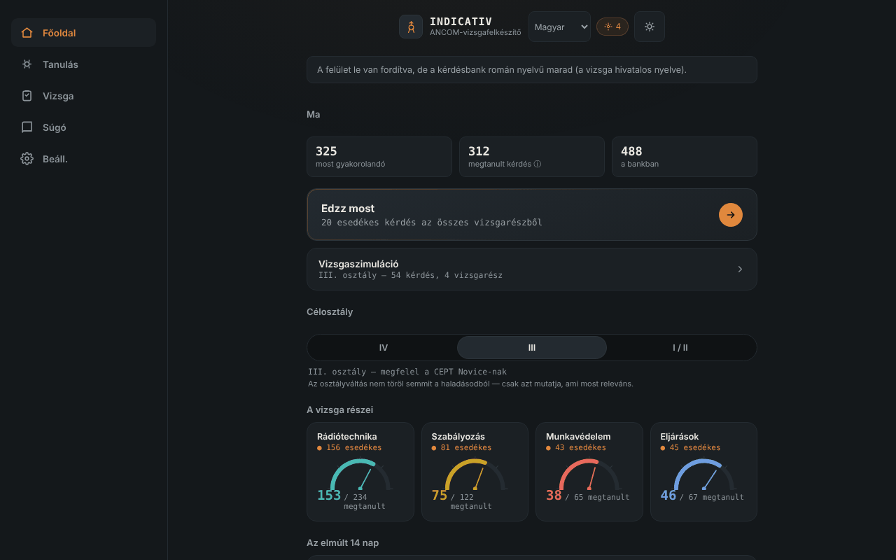

# INDICATIV — felkészítő az ANCOM rádióamatőr-vizsgához

[English](README.md) · [Română](README.ro.md) · [Français](README.fr.md) · [Italiano](README.it.md) · [Español](README.es.md) · [Português](README.pt.md) · [Deutsch](README.de.md) · **Magyar**

**Verzió:** 1.3.7 · **Utolsó frissítés:** 2026-10-23

A felület nyelvei: **Română, English, Français, Italiano, Español, Português (PT), Deutsch, Magyar**

Offline, nem hivatalos felkészítő az ANCOM rádióamatőr-vizsgához: időzített ismétlés és szimulált vizsga, egyetlen HTML-fájlban. Az [ETER](https://chiuta.github.io/ETER/) társa.

**Online alkalmazás:** https://chiuta.github.io/INDICATIV/

## Mi ez

Az INDICATIV személyes tanulási projekt a romániai leendő rádióamatőröknek. 723 kérdésből álló bankot tartalmaz, négy válaszlehetőséggel, a vizsga részei szerint felosztva: rádiótechnika (469), szabályozás (122), üzemeltetési eljárások (67) és munkavédelem (65). Az alkalmazás helyben megjegyzi, mit rontottál el, és ezeket a kérdéseket gyakrabban mutatja.

**Az alkalmazás nem hivatalos ANCOM-anyag**, nem az ANCOM készítette vagy hagyta jóvá, és nincs jogi értéke. A tényleges vizsga eltérhet (kérdések, szerkezet, frissített szabályozás).

## Funkciók

A kódban és a böngészőben ellenőrizve:
- Gyakorlás időzített ismétléssel (SM-2 típusú algoritmus): a lejárt és az új kérdések jelennek meg először; az elrontottak ugyanabban a körben visszatérnek néhány kártya után. A kör mérete: 10, 20 vagy 30 kérdés.
- A célosztály kiválasztása (IV, III, I/II); az alkalmazás a releváns vizsgarészeket mutatja (a IV. osztálynak nincs rádiótechnika-vizsgarésze; a III. osztálynál a rádiótechnika csak az A és B szintű kérdéseket használja).
- Szimulált vizsga az ANCOM 245/2017. számú határozata szerinti vizsgarészek szerkezetével (kérdésszám és vizsgarészenkénti minimális küszöb), menet közbeni visszajelzés nélkül, ADMIS/RESPINS (megfelelt/nem felelt meg) eredménnyel és a hibák áttekintésével.
- „Csak a hibák áttekintése”, „Gyors ismétlés” (szabályozás + eljárások), „Végső hajrá”, a megszakított kör folytatása.
- Haladásjelző vizsgarészenként, tanulónapok sorozata és az utolsó 14 nap grafikonja.
- Referencia: fonetikus ábécé (hangos felolvasással, ha a böngésző kínálja), Q-kódok, rövidítések, RST-jelentés, vészjelzések, vészhelyzeti frekvenciák (tájékoztató jellegű, aktualitása nem ellenőrzött).
- Különálló helyi profilok, automatikus/világos/sötét téma, haladási összefoglaló, a haladás exportja/importja (JSON), visszaállítás.
- „Keresés a kérdésbankban” (a Referencia képernyőn): a kérdésszövegben és a válaszlehetőségekben keres, az ékezetektől függetlenül, és megmutatja a helyes választ; az eredmények 30-ra korlátozottak, üzenetekkel a túl rövid vagy eredmény nélküli lekérdezésekhez.
- Billentyűparancsok a kvízben: az 1–4 kiválasztja a lehetőséget, az Enter/Szóköz továbblép.

## Újdonságok (v1.1.0, 2026. október 14.)

**Megjegyzés:** a vizsga mód már létezett (szimulált vizsga a vizsgarészek szerkezetével, menet közbeni visszajelzés nélkül, ADMIS/RESPINS eredménnyel és a hibák áttekintésével). Nem duplikáltam; hozzáadtam, ami hiányzott:

### Opcionális időzítő a szimulált vizsgán
A „Szimulált vizsga” képernyőn időkorlátot választasz: **Nincs** (alapértelmezett), 30, 60 vagy 90 perc. **A vizsga hivatalos időtartamát ez az alkalmazás nem határozza meg** (nem erősítettem meg hivatalos forrásból), ezért az értéket te választod. Az időzítő (`role="timer"`) a kérdéssávban jelenik meg, az utolsó 5 percben pirosra vált, képernyőolvasók számára 10, 5 és 1 percnél jelez, és határidőn alapul (`Date.now`), így nem fagy le, ha a lap a háttérben van. Lejáratkor a vizsga automatikusan véget ér: **a megválaszolatlan kérdések rossznak számítanak**, és az értékelés ezt közli. A vizsga feladása leállítja az időzítőt. A választás a helyi profilban marad (`settings.examMinutes`).

### A szimulált vizsgák előzményei
A „Szimulált vizsga” képernyő az utolsó 5 vizsgát mutatja (dátum, osztály, ADMIS/RESPINS, esetenként „lejárt az idő”). Az adatok már léteztek a profilban (`examLog`); most láthatók. A haladás exportja/importja megőrzi őket.

### Átláthatóság és biztonsági mentés (fff-kit)

A megjelenített verzióra (`v 1.1.0 · 2026-10-14`) kattintva (vagy Entert nyomva) megnyílik az „Átláthatóság” ablak: a deklarált hálózati gazdagépek (0 külső kérés), a helyi tárolókulcsok méretekkel, a használt API-k, a fájl mérete és SHA-256 értéke (egy letöltött fájlhoz való ellenőrzővel) és az alkalmazás adatainak **biztonsági mentése** egy `.fff.json` fájlba (opcionálisan jelszóval titkosítva, AES-GCM 256 / PBKDF2; a jelszó nem állítható vissza), importálás megerősítéssel és az alkalmazás adatainak törlése. A készlet (`fff-kit`, modulok: core, label, bundle) be van illesztve az `index.html` fájlba, nem küld hálózati kéréseket, és nem módosítja a meglévő adatokat; nélküle az alkalmazás ugyanúgy működik. A készlet biztonsági mentése az INDICATIV-profilok `localStorage`-kulcsait fedi le (haladás, beállítások, előzmények); az alkalmazás saját exportja („Beállítások” → haladás exportálása) továbbra is elérhető. A készlet szövegei 8 nyelven vannak (ro, en, fr, it, es, pt, hu, de); **az fr/it/es/pt/hu/de fordítások automatikusak, és anyanyelvi beszélők nem ellenőrizték őket**. Maga az alkalmazás felülete román marad.

## Használati útmutató

1. Nyisd meg az oldalt, és olvasd el az üdvözlő üzenetet.
2. A „Kezdőlap” képernyőn válaszd ki a célosztályt (IV, III vagy I/II).
3. Nyomd meg a „Gyakorolj most” gombot, vagy válassz egy vizsgarészt a „Tanulás” menüből.
4. Válaszolj a kérdésekre; minden válasz után nyomd meg a „Tovább” gombot.
5. A „Vizsga” menüből teljes szimulációt indíthatsz a választott osztályra.
6. A „Beállításokban” exportálod a haladást (JSON-fájl) tartalékként, és később importálhatod.

## Adatvédelem és hálózat

- **Tárolás:** a haladás (ismétlések, statisztikák, beállítások, profilok) a böngésző `localStorage`-ában mentődik, csak az eszközödön, hibakezeléssel (ha a tárolás blokkolt, az alkalmazás mentés nélkül működik). Nem használ sütiket, `sessionStorage`-ot vagy IndexedDB-t.
- **Hálózat:** az alkalmazás nem kezdeményez hálózati hívást (nincs `fetch`, nincsenek külső erőforrások, nincsenek külső gazdagépek). Az oldalon szigorú CSP-szabály van érvényben (`default-src 'none'`). Az egyetlen hivatkozás egy `mailto:` a szerzőnek, amely csak akkor nyílik meg, ha megnyomod.
- **Engedélyek:** nem kér engedélyeket (sem mikrofont, sem helyadatot, sem kamerát). A fonetikus ábécé hangos felolvasása a böngésző/rendszer beszédszintézisét használja; egyes böngészőkben a hangokat a böngésző gyártója online biztosíthatja, az alkalmazás ellenőrzésén kívül.
- A haladás exportja egy helyben letöltött fájl; az importálás egy általad választott fájlt olvas be, és használat előtt ellenőrzi.

## Korlátok és figyelmeztetések

- **A kérdések fordításai (v1.3.1):** mind a 723 kérdés (kérdés és 4 válaszlehetőség) elérhető en, fr, it, es, pt, de, hu nyelven is, a hivatalos román szöveg alatt megjelenítve (kapcsoló a Beállításokban; a keresés ezekre is kiterjed). A román szöveg marad a hivatalos vizsgaszöveg; a fordítások **tanulássegédletek**, automatikusak, anyanyelvi beszélők nem ellenőrizték, és az alkalmazás nem hivatalosként jelöli őket. A szabályozási tartalom (ANCOM 245/2017. sz. határozat, eljárások) és a munkavédelmi / elsősegély-kérdések (pl. áramütés) hű fordítások hozzáadott tanács nélkül, és **szakmai vagy jogi felülvizsgálatot igényelnek**.
- **Nem hivatalos:** nem ANCOM-anyag; a hatályos hivatalos szövegek az ANCOM-nál találhatók (ancom.ro, Rádióamatőrök szakasz). Az ANCOM 245/2017. számú határozata (2022. 03. 31-i egységes szerkezetű szöveg, a 139/2022. számú határozattal módosítva) a szabályozás alapja, a 2026 októberében megtekintett ANCOM-oldal szerint.
- **A kérdésbank:** részben ellenőrzött. A rádiótechnika számszerű válaszait (150-nél több kérdés) szkripttel újraszámoltam, és nem találtam hibás választ; a többi kérdést (fogalmi, szabályozási, eljárási, munkavédelmi) nem erősítettem meg egyenként. Egyes válaszok a tananyag megfogalmazását tükrözik, és elavultak lehetnek (például a fázisvezetők színei, a pontos 70 cm-es sávok, az állomásnapló megőrzési ideje). Ha hibát találsz, írj a szerzőnek (a kérdés kódja a fölötte lévő címkében látható).
- **A kérdések eredete és jogai:** a rádiótechnika I–III. fejezete a szerző szerint az ANCOM által közzétett „Tárgylistából” származik; a IV–IX. fejezet közösségi forrásokból (a SimEx projekt), amelyekre a szerző a GNU GPL licencet említi; a többi az ANCOM Iași-nak és a rádióamatőr-közösségnek tulajdonított tananyagokból. E szövegek jogi státusza nincs tisztázva; ezért a tároló nem deklarál licencet a tartalomra (lásd lejjebb).
- A válaszlehetőségek nincsenek összekeverve (a hivatalos anyag sorrendje megmarad), mert egyes kérdések „az előző válaszokra” hivatkoznak.
- A vizsgaszimuláció oktató jellegű: az ADMIS/RESPINS eredmény nem előlegezi meg a tényleges vizsga eredményét.
- A távirdászat nem vizsgarész a határozat vizsgaszerkezetében, és itt nem gyakorolható.

## Futtatás helyben / offline

Töltsd le az `index.html` fájlt, és nyisd meg a böngészőben; internet nélkül teljes mértékben működik.

## Előzmények / Changelog

### 1.3.6 — 2026-10-22

fff-kit 1.1.4: érintési célok és minimális szövegméret. Érintési célok/szöveg javítva az alkalmazásban.

### 1.3.5 — 2026-10-22

fff-kit 1.1.2: PBKDF2 600 000 iterációval, clickjacking elleni védelem.
### 1.3.4 — 2026-10-22
- Offline: valódi service worker és ikonokkal ellátott webalkalmazás-manifest került be (telepíthető; az első látogatás után kapcsolat nélkül is megnyílik). A régi inline data: manifest eltávolításra került.
- Az előrehaladás importálásakor megjelenő blokkoló `alert()` üzenetek és a profil hozzáadásához használt böngésző-`prompt()` helyét nem modális értesítés és alkalmazáson belüli párbeszédablak vette át (mind a 8 nyelvre lefordítva).

### 1.3.3 — 2026-10-22
- A rejtett „0 / 0 helyes” és „Minden vizsgarészt teljesítettél” sablonok mostantól a nyelvi szótárban vannak (8 nyelv).

### 1.3.2 — 2026-10-22
- Fordítási javítás: a folytatás-sáv, a gyakorlás és az átismétlés alfeliratai, valamint a vizsga „Hibák átismétlése” gombja más nyelveken már nem jelenít meg román szöveget.

- 1.3.1 — 2026-10-19: fordítási segédlet a teljes kérdésbankhoz (723 kérdés) 7 nyelven, a hivatalos román szöveg alatt megjelenítve; a kategóriák, a tárgyak és a 19 képlettipp is le van fordítva.
- 1.2.0 — 2026-10-19: a válasz után, a gyakorlásnál „olvasd el az ETER-ben” hivatkozás (új lap) a kérdés témáját lefedő szakaszra (a 723 kérdésből kb. 136); hivatkozás az Ábécékre a fonetikus referenciánál. Csak hivatkozások, hálózati kérések nélkül.
- 1.1.0 — 2026-10-14: opcionális időzítő a szimulált vizsgán (automatikus lezárással és a hátralévő kérdések rossznak számításával); az utolsó 5 vizsga előzményei; fff-kit készlet (Átláthatóság + biztonsági mentés). A kérdésbank nem változott.

- 1.0.0 — 2026-10-12: a verzió és az utolsó frissítés dátuma megjelenik az alkalmazásban
- A gyakorlásnál a válasz után megjelenő képletek most a 216 számszerű rádiótechnika-kérdésből 100-at fednek le (korábban 29): soros és párhuzamos ellenállások, soros ellenállású izzó, induktivitás ferritgyűrűn (AL), sávszélesség és modulációs index NBFM-nél, teljesítmény a terhelésen, dBd nyereségarány, SI-előtagok és frekvencia–periódusidő. Minden családot szkripttel számszerűen ellenőriztem az összes megfelelő kérdés helyes válaszával szemben (56 kiszámítható kérdés, 0 eltérés).
- A gyakorlásnál minden válasz után most megjelenik a helyes válasz, a kérdés témája és, ha van, a hasznos képlet (nem csak „Helyes.”). A banknak mind a 723 kérdéséhez még nincsenek egyedi magyarázatai.
- Hozzáadva a keresés a kérdésbankban (Referencia); az alkalmazás címe most `<h1>`, a Referencia képernyő pedig helyes címsorhierarchiát használ; nyomtatási stílus (navigációs sáv nélkül); CSP: `script-src` SHA-256 hash alapján, `'unsafe-inline'` nélkül.
- A felületen és a bankban lévő cedillás ékezetes betűket (ş, ţ) a helyes vesszős alakra (ș, ț) cseréltük.
- A mobilon lévő navigációs sáv most követi a témát (korábban mindig sötét volt, a világos témában elégtelen kontraszttal).
- Szemantikus szerkezet (`header`, `main`, `nav`) az akadálymentességhez; axe-core: 0 hiba 1280 és 360 px-en.
- A szabályozást 2026. 10. 11-én nem lehetett önállóan újraellenőrizni; a „Korlátok és figyelmeztetések” szövege a 2026. októberi marad, az ANCOM-ra hivatkozva.

## Licenc

A licenc még nincs deklarálva. A kérdések eredete miatt (beleértve a GNU GPL alatt említett közösségi anyagokat) a tartalomhoz tartozó licenc kiválasztása a jogok tisztázásától függ.

## Szerző

Alexio — Alexandru-Ionuț Chiuță, kapcsolat: alexio@trom.tf

## Összefoglaló

Az INDICATIV egyetlen fájlból álló, offline, nem hivatalos felkészítő (román nyelvű) az ANCOM rádióamatőr-vizsgához: 723 feleletválasztós kérdés, SM-2 időzített ismétlés és az ANCOM 245/2017. számú határozatának szerkezetét követő szimulált vizsga. A haladás csak a böngésző `localStorage`-ában tárolódik; az alkalmazás nem küld hálózati kéréseket (szigorú CSP). Nem hivatalos ANCOM-anyag; a kérdésszövegek licencelése nincs tisztázva, ezért még nincs deklarált licenc.
