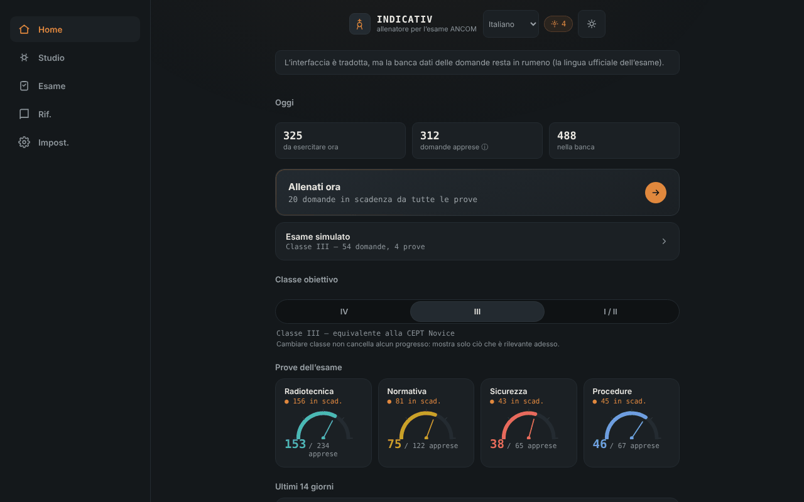

# INDICATIV — allenatore per l'esame ANCOM di radioamatore

[English](README.md) · [Română](README.ro.md) · [Français](README.fr.md) · **Italiano** · [Español](README.es.md) · [Português](README.pt.md) · [Deutsch](README.de.md) · [Magyar](README.hu.md)

**Versione:** 1.3.1 · **Ultimo aggiornamento:** 2026-10-19

Lingue dell'interfaccia: **Română, English, Français, Italiano, Español, Português (PT), Deutsch, Magyar**

Allenatore offline, non ufficiale, per l'esame ANCOM di radioamatore: ripetizione dilazionata ed esame simulato, in un unico file HTML. Compagno di [ETER](https://chiuta.github.io/ETER/).

**Applicazione online:** https://chiuta.github.io/INDICATIV/

## Che cos'è

INDICATIV è un progetto di studio personale per i futuri radioamatori della Romania. Contiene una banca di 723 domande con quattro risposte possibili, suddivise secondo le prove dell'esame: radiotecnica (469), regolamentazione (122), procedure operative (67) e sicurezza sul lavoro (65). L'applicazione ricorda localmente ciò che hai sbagliato e ti mostra più spesso quelle domande.

**L'applicazione non è materiale ufficiale ANCOM**, non è realizzata né approvata da ANCOM e non ha valore giuridico. L'esame reale può differire (domande, struttura, normativa aggiornata).

## Funzionalità

Verificato nel codice e nel browser:
- Allenamento con ripetizione dilazionata (algoritmo di tipo SM-2): le domande in scadenza e quelle nuove compaiono per prime; quelle sbagliate ritornano nello stesso turno dopo alcune schede. Dimensione del turno: 10, 20 o 30 domande.
- Scelta della classe di riferimento (IV, III, I/II); l'applicazione mostra le prove pertinenti (la classe IV non ha la prova di radiotecnica; per la classe III la radiotecnica usa solo le domande di livello A e B).
- Esame simulato con la struttura delle prove della Decisione ANCOM 245/2017 (numero di domande e soglia minima per prova), senza riscontro durante la prova, con risultato ADMIS/RESPINS (ammesso/respinto) e revisione degli errori.
- «Rivedi solo gli errori», «Ripasso rapido» (regolamentazione + procedure), «Sprint finale», ripresa di un turno interrotto.
- Indicatore di avanzamento per prova, serie di giorni di studio e grafico degli ultimi 14 giorni.
- Riferimento: alfabeto fonetico (con lettura vocale, se il browser la offre), codici Q, abbreviazioni, rapporto RST, segnali di soccorso, frequenze di emergenza (indicativo, non verificato come aggiornato).
- Profili locali separati, tema automatico/chiaro/scuro, riepilogo dei progressi, esportazione/importazione dei progressi (JSON), reimpostazione.
- «Ricerca nella banca di domande» (nella schermata Riferimento): cerca nel testo e nelle risposte, senza tener conto dei segni diacritici, e mostra la risposta corretta; risultati limitati a 30, con messaggi per le ricerche troppo brevi o senza risultati.
- Scorciatoie da tastiera nel quiz: 1–4 scelgono la risposta, Invio/Spazio proseguono.

## Novità (v1.1.0, 14 ottobre 2026)

**Nota:** la modalità esame esisteva già (esame simulato con la struttura delle prove, senza riscontro durante la prova, risultato ADMIS/RESPINS e revisione degli errori). Non è stata duplicata; ho aggiunto ciò che mancava:

### Cronometro facoltativo nell'esame simulato
Nella schermata «Esame simulato» scegli un limite di tempo: **Nessuno** (predefinito), 30, 60 o 90 minuti. **La durata ufficiale dell'esame non è stabilita in questa applicazione** (non l'ho confermata da una fonte ufficiale), quindi il valore lo scegli tu. Il cronometro (`role="timer"`) compare nella barra della domanda, diventa rosso negli ultimi 5 minuti, annuncia a 10, 5 e 1 minuto per gli screen reader e si basa su una scadenza (`Date.now`), quindi non si blocca con la scheda in background. Alla scadenza l'esame si conclude automaticamente: **le domande rimaste senza risposta sono contate come sbagliate**, e il verdetto lo precisa. L'abbandono dell'esame ferma il cronometro. La scelta viene conservata nel profilo locale (`settings.examMinutes`).

### Cronologia degli esami simulati
La schermata «Esame simulato» mostra gli ultimi 5 esami (data, classe, ADMIS/RESPINS, «tempo scaduto», a seconda dei casi). I dati esistevano già nel profilo (`examLog`); ora sono visibili. L'esportazione/importazione dei progressi li conserva.

### Trasparenza e copia di sicurezza (fff-kit)

Un clic (o Invio) sulla versione mostrata (`v 1.1.0 · 2026-10-14`) apre la finestra «Trasparenza»: gli host di rete dichiarati (0 richieste esterne), le chiavi di archiviazione locale con le dimensioni, le API utilizzate, la dimensione e lo SHA-256 del file (con un verificatore per un file scaricato) e la **copia di sicurezza** dei dati dell'applicazione in un file `.fff.json` (facoltativamente cifrato con password, AES-GCM 256 / PBKDF2; la password non può essere recuperata), l'importazione con conferma e la cancellazione dei dati dell'applicazione. Il kit (`fff-kit`, moduli: core, label, bundle) è incollato in `index.html`, non effettua richieste di rete e non modifica i dati esistenti; senza di esso l'applicazione funziona allo stesso modo. La copia di sicurezza del kit comprende le chiavi `localStorage` dei profili INDICATIV (progressi, impostazioni, cronologia); l'esportazione propria dell'applicazione («Impostazioni» → esporta progressi) resta disponibile. I testi del kit sono in 8 lingue (ro, en, fr, it, es, pt, hu, de); **le traduzioni fr/it/es/pt/hu/de sono automatiche e non verificate da madrelingua**. L'interfaccia dell'applicazione stessa resta in rumeno.

## Guida all'uso

1. Apri la pagina e leggi il messaggio di benvenuto.
2. Nella schermata «Home» scegli la classe di riferimento (IV, III o I/II).
3. Premi «Allenati ora» o scegli una prova da «Studio».
4. Rispondi alle domande; dopo ogni risposta premi «Continua».
5. Da «Esame» avvii una simulazione completa per la classe scelta.
6. In «Impostazioni» esporti i progressi (file JSON) come copia di riserva e puoi importarli in seguito.

## Privacy e rete

- **Archiviazione:** i progressi (ripetizioni, statistiche, impostazioni, profili) vengono salvati nel `localStorage` del browser, solo sul tuo dispositivo, con gestione degli errori (se l'archiviazione è bloccata, l'applicazione funziona senza salvataggio). Non usa cookie, `sessionStorage` o IndexedDB.
- **Rete:** l'applicazione non effettua alcuna chiamata di rete (niente `fetch`, risorse esterne, host esterni). La pagina ha una policy CSP restrittiva (`default-src 'none'`). L'unico link è un `mailto:` verso l'autore, che si apre solo se lo premi.
- **Permessi:** non richiede permessi (né microfono, né posizione, né fotocamera). La lettura vocale dell'alfabeto fonetico usa la sintesi vocale del browser/sistema; in alcuni browser le voci possono essere fornite online dal produttore del browser, al di fuori del controllo dell'applicazione.
- L'esportazione dei progressi è un file scaricato localmente; l'importazione legge un file scelto da te e lo convalida prima di usarlo.

## Limiti e avvertenze

- **Non ufficiale:** non è materiale ANCOM; i testi ufficiali in vigore si trovano presso ANCOM (ancom.ro, sezione Radioamatori). La Decisione ANCOM 245/2017 (testo consolidato al 31.03.2022, modificata dalla Decisione 139/2022) è la base della normativa, secondo la pagina ANCOM consultata a ottobre 2026.
- **La banca di domande:** è stata verificata parzialmente. Le risposte numeriche di radiotecnica (oltre 150 domande) sono state ricalcolate con uno script e non sono state trovate risposte errate; le altre domande (concettuali, di regolamentazione, di procedure, di sicurezza sul lavoro) non sono state confermate singolarmente. Alcune risposte riflettono la formulazione del materiale di studio e possono essere superate (ad esempio i colori dei conduttori di fase, le bande esatte dei 70 cm, il periodo di conservazione del giornale di stazione). Se trovi un errore, scrivi all'autore (il codice della domanda compare nell'etichetta sopra di essa).
- **Provenienza e diritti sulle domande:** i capitoli I–III di radiotecnica provengono, secondo l'autore, dall'«Elenco degli argomenti» pubblicato da ANCOM; i capitoli IV–IX da fonti della comunità (il progetto SimEx), per le quali l'autore menziona la licenza GNU GPL; il resto da materiali di studio attribuiti ad ANCOM Iași e alla comunità dei radioamatori. Lo status giuridico di questi testi non è stato chiarito; per questo il repository non dichiara una licenza per il contenuto (vedi sotto).
- Le risposte possibili non vengono mescolate (si mantiene l'ordine del materiale ufficiale), perché alcune domande si riferiscono alle «risposte precedenti».
- La simulazione d'esame è didattica: il risultato ADMIS/RESPINS non anticipa il risultato all'esame reale.
- La telegrafia non è una prova nella struttura dell'esame della decisione e qui non viene allenata.

## Esecuzione in locale / offline

Scarica `index.html` e aprilo nel browser; funziona completamente senza internet.

## Cronologia / Changelog
- 1.2.0 — 2026-10-19: dopo la risposta, nell'allenamento, link «leggi in ETER» (nuova scheda) verso la sezione che copre l'argomento della domanda (~136 su 723 domande); link ad Alfabeti nel riferimento fonetico. Solo collegamenti, nessuna richiesta di rete.
- 1.1.0 — 2026-10-14: cronometro facoltativo nell'esame simulato (con chiusura automatica e domande rimaste contate come sbagliate); cronologia degli ultimi 5 esami; kit fff-kit (Trasparenza + copia di sicurezza). La banca di domande non è cambiata.

- 1.0.0 — 2026-10-12: la versione e la data dell'ultimo aggiornamento sono mostrate nell'applicazione
- Le formule mostrate dopo la risposta nell'allenamento coprono ora 100 delle 216 domande numeriche di radiotecnica (rispetto a 29): resistenze in serie e in parallelo, lampadina con resistenza in serie, induttanza su toroide di ferrite (AL), larghezza di banda e indice di modulazione NBFM, potenza sul carico, rapporto di guadagno dBd, prefissi SI e frequenza–periodo. Ogni famiglia è stata verificata numericamente con uno script rispetto alla risposta corretta di tutte le domande corrispondenti (56 domande calcolabili, 0 discordanze).
- Dopo ogni risposta nell'allenamento vengono ora mostrati la risposta corretta, l'argomento della domanda e, quando esiste, la formula utile (non più solo «Corretto.»). Spiegazioni individuali per tutte le 723 domande non esistono ancora nella banca.
- Aggiunta la ricerca nella banca di domande (Riferimento); il titolo dell'applicazione è ora `<h1>` e la schermata Riferimento usa una gerarchia di titoli corretta; stile di stampa (senza barra di navigazione); CSP: `script-src` tramite hash SHA-256, senza `'unsafe-inline'`.
- I segni diacritici con cediglia (ş, ţ) nell'interfaccia e nella banca sono stati sostituiti con la forma corretta con virgola (ș, ț).
- La barra di navigazione su mobile segue ora il tema (era sempre scura, con contrasto insufficiente nel tema chiaro).
- Struttura semantica (`header`, `main`, `nav`) per l'accessibilità; axe-core: 0 violazioni a 1280 e 360 px.
- La normativa non ha potuto essere riverificata in modo indipendente all'11.10.2026; il testo di «Limiti e avvertenze» resta quello di ottobre 2026, con rinvio ad ANCOM.

## Licenza

La licenza non è ancora dichiarata. A causa della provenienza delle domande (compresi materiali della comunità menzionati sotto GNU GPL), la scelta di una licenza per il contenuto dipende dal chiarimento dei diritti.

## Autore

Alexio — Alexandru-Ionuț Chiuță, contatto: alexio@trom.tf

## Riepilogo

INDICATIV è un allenatore in un unico file, offline e non ufficiale (in rumeno) per l'esame ANCOM di radioamatore: 723 domande a scelta multipla, ripetizione dilazionata SM-2 e un esame simulato che segue la struttura della Decisione ANCOM 245/2017. I progressi sono memorizzati solo nel `localStorage` del browser; l'applicazione non effettua richieste di rete (CSP rigorosa). Non è materiale ufficiale ANCOM; la licenza dei testi delle domande non è risolta, quindi non è ancora dichiarata alcuna licenza.
