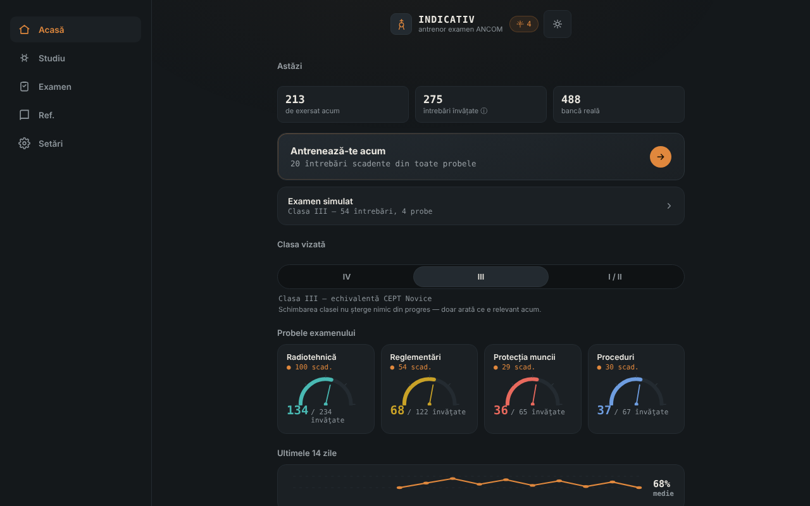

# INDICATIV — antrenor pentru examenul ANCOM de radioamator

Antrenor offline, neoficial, pentru examenul ANCOM de radioamator: repetiție spațiată și examen simulat, într-un singur fișier HTML. Însoțitor al [ETER](https://chiuta.github.io/ETER/).

**Live:** https://chiuta.github.io/INDICATIV/

## Ce este

INDICATIV este un proiect personal de studiu pentru viitorii radioamatori din România. Conține o bancă de 723 de întrebări cu patru variante de răspuns, împărțite pe probele examenului: radiotehnică (469), reglementări (122), proceduri de operare (67) și protecția muncii (65). Aplicația reține local ce ai greșit și îți arată mai des acele întrebări.

**Aplicația nu este material oficial ANCOM**, nu este realizată sau avizată de ANCOM și nu are valoare juridică. Examenul real poate diferi (întrebări, structură, reglementări actualizate).

## Funcții

Verificate în cod și în browser:
- Antrenament cu repetiție spațiată (algoritm de tip SM-2): întrebările scadente și cele noi apar primele; cele greșite revin în aceeași rundă după câteva cartonașe. Mărimea rundei: 10, 20 sau 30 de întrebări.
- Alegerea clasei vizate (IV, III, I/II); aplicația arată probele relevante (clasa IV nu are probă de radiotehnică; la clasa III radiotehnica folosește doar întrebările de nivel A și B).
- Examen simulat cu structura probelor din Decizia ANCOM 245/2017 (număr de întrebări și prag minim pe probă), fără feedback pe parcurs, cu rezultat ADMIS/RESPINS și revizuirea greșelilor.
- „Revizuiește doar greșelile”, „Recapitulare rapidă” (reglementări + proceduri), „Sprint final”, reluarea unei runde întrerupte.
- Indicator de progres pe probă, serie de zile de studiu și graficul ultimelor 14 zile.
- Referință: alfabet fonetic (cu citire vocală, dacă browserul o oferă), coduri Q, prescurtări, raportul RST, semnale de primejdie, frecvențe de urgență (orientativ, neverificat la zi).
- Profiluri locale separate, temă automată/luminoasă/întunecată, rezumat de progres, export/import al progresului (JSON), resetare.
- „Căutare în banca de întrebări” (în ecranul Referință): caută în enunț și în variante, fără a ține cont de diacritice, și arată răspunsul corect; rezultate limitate la 30, cu mesaje pentru interogări prea scurte sau fără rezultate.
- Scurtături de tastatură în quiz: 1–4 aleg varianta, Enter/Spațiu continuă.

## Manual de utilizare

1. Deschide pagina și citește mesajul de întâmpinare.
2. Pe ecranul „Acasă” alege clasa vizată (IV, III sau I/II).
3. Apasă „Antrenează-te acum” sau alege o probă din „Studiu”.
4. Răspunde la întrebări; după fiecare răspuns apasă „Continuă”.
5. Din „Examen” pornești o simulare completă pentru clasa aleasă.
6. În „Setări” exporți progresul (fișier JSON) ca rezervă și îl poți importa ulterior.

## Confidențialitate și rețea

- **Stocare:** progresul (repetiții, statistici, setări, profiluri) se salvează în `localStorage` al browserului, doar pe dispozitivul tău, cu tratarea erorilor (dacă stocarea e blocată, aplicația merge fără salvare). Nu folosește cookie-uri, `sessionStorage` sau IndexedDB.
- **Rețea:** aplicația nu face niciun apel de rețea (fără `fetch`, fără resurse externe, fără gazde externe). Pagina are o politică CSP restrictivă (`default-src 'none'`). Singurul link este un `mailto:` către autor, care se deschide doar dacă îl apeși.
- **Permisiuni:** nu cere permisiuni (nici microfon, nici locație, nici cameră). Citirea vocală a alfabetului fonetic folosește sinteza vocală a browserului/sistemului; la unele browsere vocile pot fi furnizate online de producătorul browserului, în afara controlului aplicației.
- Exportul progresului este un fișier descărcat local; importul citește un fișier ales de tine și îl validează înainte de a-l folosi.

## Limite și avertismente

- **Neoficial:** nu este un material ANCOM; textele oficiale în vigoare se găsesc la ANCOM (ancom.ro, secțiunea Radioamatori). Decizia ANCOM 245/2017 (text consolidat la 31.03.2022, modificată prin Decizia 139/2022) este baza reglementărilor, conform paginii ANCOM consultate în octombrie 2026.
- **Banca de întrebări:** a fost verificată parțial. Răspunsurile numerice de radiotehnică (peste 150 de întrebări) au fost recalculate cu un script și nu s-au găsit răspunsuri greșite; restul întrebărilor (conceptuale, de reglementări, proceduri, protecția muncii) nu au fost confirmate individual. Unele răspunsuri reflectă formularea din materialul de studiu și pot fi depășite (de exemplu culorile conductoarelor de fază, benzile exacte de 70 cm, perioada de păstrare a jurnalului). Dacă găsești o greșeală, scrie autorului (codul întrebării apare în eticheta de deasupra ei).
- **Proveniență și drepturi asupra întrebărilor:** capitolele I–III de radiotehnică provin, după autor, din „Lista de subiecte” publicată de ANCOM; capitolele IV–IX din surse comunitare (proiectul SimEx), pentru care autorul menționează licența GNU GPL; restul din materiale de studiu atribuite ANCOM Iași și comunității radioamatorilor. Statutul juridic al acestor texte nu a fost clarificat; de aceea repository-ul nu declară o licență pentru conținut (vezi mai jos).
- Variantele de răspuns nu sunt amestecate (ordinea din materialul oficial e păstrată), fiindcă unele întrebări se referă la „răspunsurile precedente”.
- Simularea de examen este didactică: rezultatul ADMIS/RESPINS nu anticipează rezultatul la examenul real.
- Telegrafia nu este o probă în structura examenului din decizie și nu este antrenată aici.

## Rulare locală / offline

Descarcă `index.html` și deschide-l în browser; funcționează complet fără internet.

## Istoric / Changelog

Ultima actualizare: 11 octombrie 2026.

- După fiecare răspuns în antrenament se afișează acum răspunsul corect, subiectul întrebării și, când există, formula utilă (nu doar „Corect.”). Explicații individuale pentru toate cele 723 de întrebări nu există încă în bancă.
- Adăugată căutarea în banca de întrebări (Referință); titlul aplicației este acum `<h1>`, iar ecranul Referință folosește ierarhie de titluri corectă; stil de tipărire (fără bara de navigare); CSP: `script-src` pe hash SHA-256, fără `'unsafe-inline'`.
- Diacriticele cu sedilă (ş, ţ) din interfață și din bancă au fost înlocuite cu forma corectă cu virgulă (ș, ț).
- Bara de navigare de pe mobil urmează acum tema (era mereu închisă la culoare, cu contrast insuficient în tema luminoasă).
- Structură semantică (`header`, `main`, `nav`) pentru accesibilitate; axe-core: 0 violări la 1280 și 360 px.
- Reglementările nu au putut fi reverificate independent la 11.10.2026; textul din „Limite și avertismente” rămâne cel din octombrie 2026, cu trimitere la ANCOM.

## Licență

Licența nu este încă declarată. Din cauza proveniunii întrebărilor (inclusiv materiale comunitare menționate sub GNU GPL), alegerea unei licențe pentru conținut depinde de clarificarea drepturilor.

## Autor

Alexio — Alexandru-Ionuț Chiuță, contact: alexio@trom.tf

## English summary

INDICATIV is a single-file, offline, unofficial trainer (Romanian) for the ANCOM amateur-radio exam: 723 multiple-choice questions, SM-2 spaced repetition and a simulated exam following the structure in ANCOM Decision 245/2017. Progress is stored only in the browser's `localStorage`; the app makes no network requests (strict CSP). It is not official ANCOM material; licensing of the question texts is unresolved, so no licence is declared yet.
