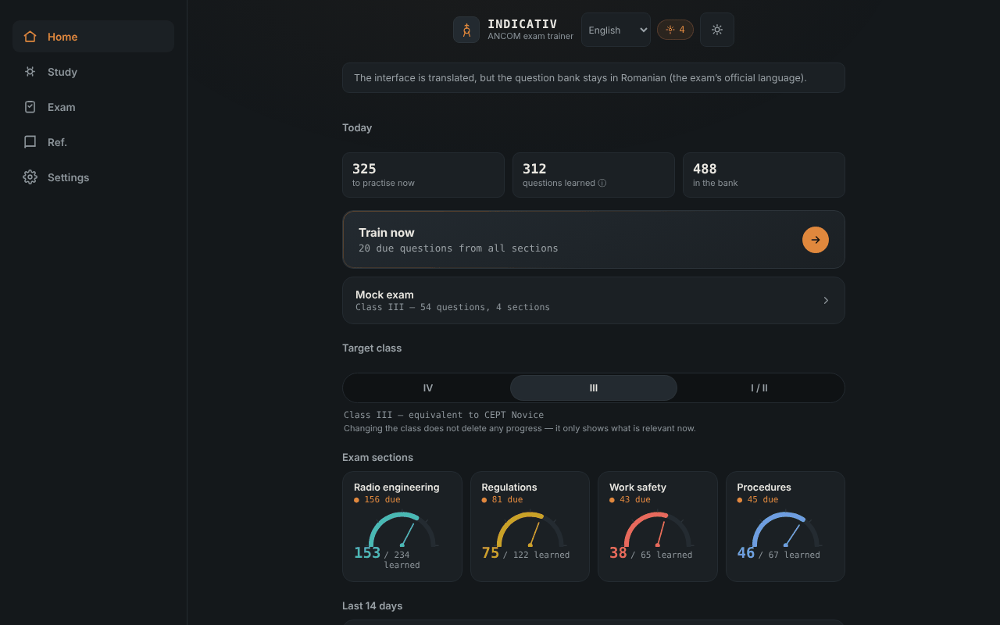

# INDICATIV — trainer for the ANCOM amateur radio exam

**English** · [Română](README.ro.md) · [Français](README.fr.md) · [Italiano](README.it.md) · [Español](README.es.md) · [Português](README.pt.md) · [Deutsch](README.de.md) · [Magyar](README.hu.md)

**Version:** 1.3.6 · **Last updated:** 2026-10-22

Interface languages: **Română, English, Français, Italiano, Español, Português (PT), Deutsch, Magyar**

An offline, unofficial trainer for the ANCOM amateur radio (radioamator) exam: spaced repetition and a simulated exam, in a single HTML file. Companion to [ETER](https://chiuta.github.io/ETER/).

**Live app:** https://chiuta.github.io/INDICATIV/

## What it is

INDICATIV is a personal study project for future radio amateurs in Romania. It contains a bank of 723 questions with four answer options, divided by the exam's tests: radio engineering (469), regulations (122), operating procedures (67) and occupational safety (65). The app remembers locally what you got wrong and shows you those questions more often.

**The app is not official ANCOM material**, is not made or endorsed by ANCOM and has no legal value. The real exam may differ (questions, structure, updated regulations).

## Features

Verified in the code and in the browser:
- Training with spaced repetition (SM-2-type algorithm): due and new questions appear first; the ones you got wrong come back in the same round after a few cards. Round size: 10, 20 or 30 questions.
- Choice of the target class (IV, III, I/II); the app shows the relevant tests (class IV has no radio engineering test; for class III radio engineering uses only the level A and B questions).
- Simulated exam with the structure of the tests from ANCOM Decision 245/2017 (number of questions and minimum threshold per test), with no feedback along the way, with a PASSED/FAILED result (ADMIS/RESPINS) and review of the mistakes.
- "Review only the mistakes", "Quick review" (regulations + procedures), "Final sprint", resuming an interrupted round.
- Progress indicator per test, study-day streak and a chart of the last 14 days.
- Reference: phonetic alphabet (with voice reading, if the browser offers it), Q codes, abbreviations, the RST report, distress signals, emergency frequencies (indicative, not verified as up to date).
- Separate local profiles, automatic/light/dark theme, progress summary, export/import of progress (JSON), reset.
- "Search the question bank" (in the Reference screen): searches the question text and the options, ignoring diacritics, and shows the correct answer; results limited to 30, with messages for queries that are too short or have no results.
- Keyboard shortcuts in the quiz: 1–4 choose the option, Enter/Space continue.

## New features (v1.1.0, 14 October 2026)

**Note:** the exam mode already existed (a simulated exam with the structure of the tests, no feedback along the way, PASSED/FAILED result and review of mistakes). It was not duplicated; I added what was missing:

### Optional timer in the simulated exam
On the "Simulated exam" screen you choose a time limit: **None** (default), 30, 60 or 90 minutes. **The official duration of the exam is not established in this app** (I did not confirm it from an official source), so you choose the value. The timer (`role="timer"`) appears in the question bar, turns red in the last 5 minutes, announces at 10, 5 and 1 minute for screen readers and is based on a deadline (`Date.now`), so it does not freeze with the tab in the background. When it expires, the exam ends automatically: **unanswered questions are counted as wrong**, and the verdict states this. Abandoning the exam stops the timer. The choice is kept in the local profile (`settings.examMinutes`).

### History of simulated exams
The "Simulated exam" screen shows the last 5 exams (date, class, PASSED/FAILED, "time expired", as applicable). The data already existed in the profile (`examLog`); now it is visible. The progress export/import keeps them.

### Transparency and backup (fff-kit)

A click (or Enter) on the displayed version (`v 1.1.0 · 2026-10-14`) opens the "Transparency" window: the declared network hosts (0 external requests), the local storage keys with sizes, the APIs used, the size and SHA-256 of the file (with a verifier for a downloaded file) and the **backup** of the app's data to a `.fff.json` file (optionally encrypted with a password, AES-GCM 256 / PBKDF2; the password cannot be recovered), import with confirmation and deletion of the app's data. The kit (`fff-kit`, modules: core, label, bundle) is pasted into `index.html`, makes no network requests and does not change existing data; without it the app works the same. The kit's backup covers the `localStorage` keys of the INDICATIV profiles (progress, settings, history); the app's own export ("Settings" → export progress) remains available. The kit's texts are in 8 languages (ro, en, fr, it, es, pt, hu, de); **the fr/it/es/pt/hu/de translations are automatic and not verified by native speakers**. The app's interface itself remains in Romanian.

## User guide

1. Open the page and read the welcome message.
2. On the "Home" screen choose the target class (IV, III or I/II).
3. Press "Train now" or choose a test from "Study".
4. Answer the questions; after each answer press "Continue".
5. From "Exam" you start a full simulation for the chosen class.
6. In "Settings" you export progress (JSON file) as a backup and can import it later.

## Privacy and network

- **Storage:** progress (repetitions, statistics, settings, profiles) is saved in the browser's `localStorage`, only on your device, with error handling (if storage is blocked, the app works without saving). It uses no cookies, `sessionStorage` or IndexedDB.
- **Network:** the app makes no network calls (no `fetch`, no external resources, no external hosts). The page has a restrictive CSP policy (`default-src 'none'`). The only link is a `mailto:` to the author, which opens only if you press it.
- **Permissions:** it asks for no permissions (no microphone, location or camera). Voice reading of the phonetic alphabet uses the browser's/system's speech synthesis; in some browsers the voices may be provided online by the browser's vendor, outside the app's control.
- The progress export is a locally downloaded file; the import reads a file chosen by you and validates it before using it.

## Limits and warnings

- **Translations of the questions (v1.3.1):** all 723 questions (statement and 4 options) are also available in en, fr, it, es, pt, de, hu, shown under the official Romanian text (toggle in Settings; the search also covers them). The Romanian text remains the official exam text; the translations are a **study aid**, automatic, not verified by native speakers and flagged in the app as unofficial. The regulatory content (ANCOM Decision 245/2017, procedures) and the occupational safety / first-aid questions (e.g. electrocution) are faithful translations without added advice and **need specialist or legal review**.
- **Unofficial:** it is not ANCOM material; the official texts in force are found at ANCOM (ancom.ro, the Radio amateurs section). ANCOM Decision 245/2017 (consolidated text of 31.03.2022, amended by Decision 139/2022) is the basis of the regulations, according to the ANCOM page consulted in October 2026.
- **The question bank:** it has been partially verified. The numerical radio engineering answers (over 150 questions) were recalculated with a script and no wrong answers were found; the remaining questions (conceptual, regulations, procedures, occupational safety) were not confirmed individually. Some answers reflect the wording of the study material and may be out of date (for example the colours of phase conductors, the exact 70 cm bands, the retention period of the log). If you find a mistake, write to the author (the question code appears in the label above it).
- **Provenance and rights over the questions:** chapters I–III of radio engineering come, according to the author, from the "List of subjects" published by ANCOM; chapters IV–IX from community sources (the SimEx project), for which the author mentions the GNU GPL license; the rest from study materials attributed to ANCOM Iași and the radio amateur community. The legal status of these texts has not been clarified; therefore the repository declares no license for the content (see below).
- The answer options are not shuffled (the order from the official material is kept), because some questions refer to "the previous answers".
- The exam simulation is didactic: the PASSED/FAILED result does not predict the result at the real exam.
- Telegraphy is not a test in the exam structure of the decision and is not trained here.

## Running locally / offline

Download `index.html` and open it in the browser; it works fully without internet.

## History / Changelog

### 1.3.6 — 2026-10-22

fff-kit 1.1.4: touch targets and minimum text size. Touch targets/text fixed in the app.

### 1.3.5 — 2026-10-22

fff-kit 1.1.2: PBKDF2 with 600,000 iterations, anti-clickjacking protection.
### 1.3.4 — 2026-10-22
- Offline: added a real service worker and a web app manifest with icons (installable; the trainer opens without a connection after the first visit). The old inline data: manifest was removed.
- The blocking `alert()` messages on progress import and the browser `prompt()` for adding a profile were replaced by a non-modal notification and an in-app dialog (translated into all 8 languages).

### 1.3.3 — 2026-10-22
- Hidden templates “0 of 0 correct” and “You passed all sections” are now in the language dictionary (8 languages).

### 1.3.2 — 2026-10-22
- Translation fix: the resume banner, the training and review sub-labels and the exam "review mistakes" button no longer show Romanian text in other languages.

- 1.3.1 — 2026-10-19: translation aid for the whole question bank (723 questions) in 7 languages, shown under the official Romanian text; the categories, subjects and the 19 formula hints are translated too.
- 1.2.0 — 2026-10-19: after an answer, in training, a link "read in ETER" (new tab) to the section that covers the topic of the question (~136 of 723 questions); a link to Alphabets at the phonetic reference. Links only, no network requests.
- 1.1.0 — 2026-10-14: optional timer in the simulated exam (with automatic closing and remaining questions counted as wrong); history of the last 5 exams; fff-kit kit (Transparency + backup). The question bank did not change.

- 1.0.0 — 2026-10-12: the version and the date of the last update are shown in the app
- The formulas shown after an answer in training now cover 100 of the 216 numerical radio engineering questions (up from 29): series and parallel resistances, lamp with series resistor, inductance on a ferrite toroid (AL), bandwidth and modulation index of NBFM, power on a load, dBd gain ratio, SI prefixes and frequency–period. Each family was checked numerically with a script against the correct answer of all matching questions (56 computable questions, 0 mismatches).
- After each answer in training, the correct answer, the topic of the question and, when there is one, the useful formula are now shown (not just "Correct."). Individual explanations for all 723 questions do not exist yet in the bank.
- Added search in the question bank (Reference); the app title is now `<h1>`, and the Reference screen uses a correct heading hierarchy; print style (without the navigation bar); CSP: `script-src` by SHA-256 hash, without `'unsafe-inline'`.
- The cedilla diacritics (ş, ţ) in the interface and in the bank were replaced with the correct comma form (ș, ț).
- The navigation bar on mobile now follows the theme (it was always dark, with insufficient contrast in the light theme).
- Semantic structure (`header`, `main`, `nav`) for accessibility; axe-core: 0 violations at 1280 and 360 px.
- The regulations could not be independently rechecked on 11.10.2026; the text in "Limits and warnings" remains the one from October 2026, with a reference to ANCOM.

## License

The license is not yet declared. Because of the provenance of the questions (including community materials mentioned under the GNU GPL), choosing a license for the content depends on clarifying the rights.

## Author

Alexio — Alexandru-Ionuț Chiuță, contact: alexio@trom.tf

## Summary

INDICATIV is a single-file, offline, unofficial trainer (Romanian) for the ANCOM amateur-radio exam: 723 multiple-choice questions, SM-2 spaced repetition and a simulated exam following the structure in ANCOM Decision 245/2017. Progress is stored only in the browser's `localStorage`; the app makes no network requests (strict CSP). It is not official ANCOM material; licensing of the question texts is unresolved, so no licence is declared yet.
