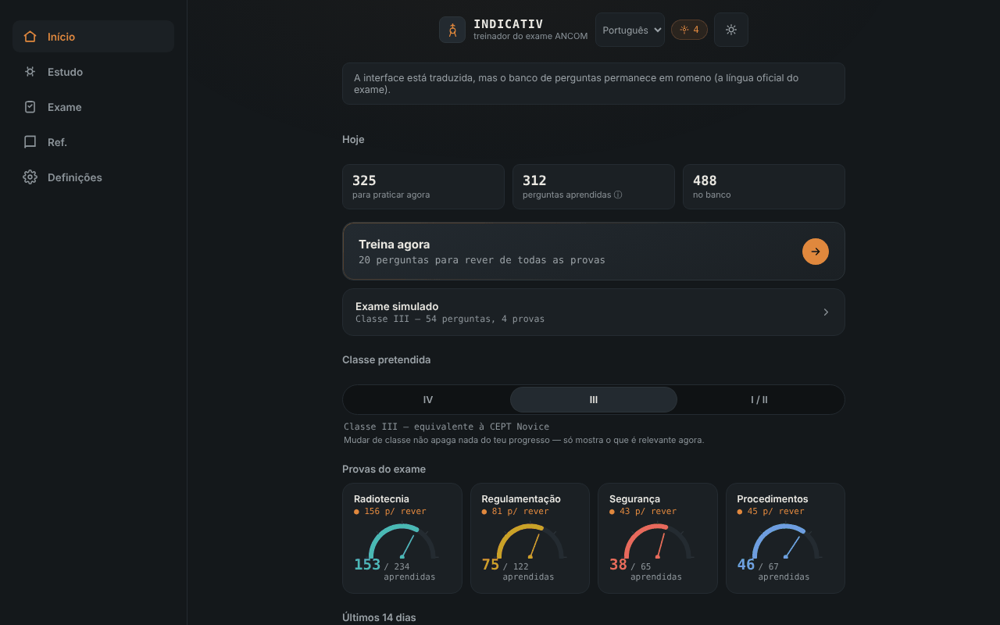

# INDICATIV — treinador para o exame ANCOM de radioamador

[English](README.md) · [Română](README.ro.md) · [Français](README.fr.md) · [Italiano](README.it.md) · [Español](README.es.md) · **Português** · [Deutsch](README.de.md) · [Magyar](README.hu.md)

**Versão:** 1.3.3 · **Última atualização:** 2026-10-22

Idiomas da interface: **Română, English, Français, Italiano, Español, Português (PT), Deutsch, Magyar**

Treinador offline, não oficial, para o exame ANCOM de radioamador: repetição espaçada e exame simulado, num único ficheiro HTML. Companheiro do [ETER](https://chiuta.github.io/ETER/).

**Aplicação online:** https://chiuta.github.io/INDICATIV/

## O que é

O INDICATIV é um projeto de estudo pessoal para os futuros radioamadores da Roménia. Contém um banco de 723 perguntas com quatro opções de resposta, repartidas pelas provas do exame: radiotecnia (469), regulamentação (122), procedimentos de operação (67) e proteção no trabalho (65). A aplicação guarda localmente o que errou e mostra-lhe essas perguntas com mais frequência.

**A aplicação não é material oficial da ANCOM**, não é realizada nem aprovada pela ANCOM e não tem valor jurídico. O exame real pode diferir (perguntas, estrutura, regulamentação atualizada).

## Funcionalidades

Verificado no código e no navegador:
- Treino com repetição espaçada (algoritmo do tipo SM-2): as perguntas vencidas e as novas aparecem primeiro; as erradas regressam na mesma ronda após alguns cartões. Tamanho da ronda: 10, 20 ou 30 perguntas.
- Escolha da classe-alvo (IV, III, I/II); a aplicação mostra as provas relevantes (a classe IV não tem prova de radiotecnia; na classe III a radiotecnia usa apenas as perguntas de nível A e B).
- Exame simulado com a estrutura das provas da Decisão ANCOM 245/2017 (número de perguntas e limiar mínimo por prova), sem feedback durante a prova, com resultado ADMIS/RESPINS (admitido/rejeitado) e revisão dos erros.
- «Rever apenas os erros», «Revisão rápida» (regulamentação + procedimentos), «Sprint final», retoma de uma ronda interrompida.
- Indicador de progresso por prova, sequência de dias de estudo e gráfico dos últimos 14 dias.
- Referência: alfabeto fonético (com leitura em voz alta, se o navegador a oferecer), códigos Q, abreviaturas, relatório RST, sinais de socorro, frequências de emergência (indicativo, não verificado como atualizado).
- Perfis locais separados, tema automático/claro/escuro, resumo do progresso, exportação/importação do progresso (JSON), reposição.
- «Pesquisa no banco de perguntas» (no ecrã Referência): pesquisa no enunciado e nas opções, sem ter em conta os sinais diacríticos, e mostra a resposta correta; resultados limitados a 30, com mensagens para pesquisas demasiado curtas ou sem resultados.
- Atalhos de teclado no questionário: 1–4 escolhem a opção, Enter/Espaço continuam.

## Novidades (v1.1.0, 14 de outubro de 2026)

**Nota:** o modo de exame já existia (exame simulado com a estrutura das provas, sem feedback durante a prova, resultado ADMIS/RESPINS e revisão dos erros). Não foi duplicado; acrescentei o que faltava:

### Cronómetro opcional no exame simulado
No ecrã «Exame simulado» escolhe um limite de tempo: **Nenhum** (predefinição), 30, 60 ou 90 minutos. **A duração oficial do exame não está estabelecida nesta aplicação** (não a confirmei numa fonte oficial), pelo que o valor é escolhido por si. O cronómetro (`role="timer"`) aparece na barra da pergunta, fica vermelho nos últimos 5 minutos, anuncia aos 10, 5 e 1 minuto para os leitores de ecrã e baseia-se num prazo (`Date.now`), pelo que não congela com o separador em segundo plano. Ao expirar, o exame termina automaticamente: **as perguntas sem resposta contam como erradas**, e o veredicto indica-o. Abandonar o exame para o cronómetro. A escolha é guardada no perfil local (`settings.examMinutes`).

### Histórico dos exames simulados
O ecrã «Exame simulado» mostra os últimos 5 exames (data, classe, ADMIS/RESPINS, «tempo expirado», conforme o caso). Os dados já existiam no perfil (`examLog`); agora são visíveis. A exportação/importação do progresso conserva-os.

### Transparência e cópia de segurança (fff-kit)

Um clique (ou Enter) na versão apresentada (`v 1.1.0 · 2026-10-14`) abre a janela «Transparência»: os anfitriões de rede declarados (0 pedidos externos), as chaves de armazenamento local com os tamanhos, as APIs utilizadas, o tamanho e o SHA-256 do ficheiro (com um verificador para um ficheiro descarregado) e a **cópia de segurança** dos dados da aplicação num ficheiro `.fff.json` (opcionalmente cifrado com palavra-passe, AES-GCM 256 / PBKDF2; a palavra-passe não pode ser recuperada), a importação com confirmação e a eliminação dos dados da aplicação. O kit (`fff-kit`, módulos: core, label, bundle) está colado no `index.html`, não faz pedidos de rede e não altera os dados existentes; sem ele a aplicação funciona da mesma forma. A cópia de segurança do kit abrange as chaves `localStorage` dos perfis do INDICATIV (progresso, definições, histórico); a exportação própria da aplicação («Definições» → exportar progresso) continua disponível. Os textos do kit estão em 8 línguas (ro, en, fr, it, es, pt, hu, de); **as traduções fr/it/es/pt/hu/de são automáticas e não foram verificadas por falantes nativos**. A interface da própria aplicação continua em romeno.

## Manual de utilização

1. Abra a página e leia a mensagem de boas-vindas.
2. No ecrã «Início» escolha a classe-alvo (IV, III ou I/II).
3. Prima «Treine agora» ou escolha uma prova em «Estudo».
4. Responda às perguntas; após cada resposta prima «Continuar».
5. A partir de «Exame» inicia uma simulação completa para a classe escolhida.
6. Em «Definições» exporta o progresso (ficheiro JSON) como cópia de segurança e pode importá-lo mais tarde.

## Privacidade e rede

- **Armazenamento:** o progresso (repetições, estatísticas, definições, perfis) é guardado no `localStorage` do navegador, apenas no seu dispositivo, com tratamento de erros (se o armazenamento estiver bloqueado, a aplicação funciona sem guardar). Não utiliza cookies, `sessionStorage` nem IndexedDB.
- **Rede:** a aplicação não faz qualquer chamada de rede (sem `fetch`, sem recursos externos, sem anfitriões externos). A página tem uma política CSP restritiva (`default-src 'none'`). A única ligação é um `mailto:` para o autor, que só se abre se o premir.
- **Permissões:** não pede permissões (nem microfone, nem localização, nem câmara). A leitura em voz alta do alfabeto fonético usa a síntese de voz do navegador/sistema; em alguns navegadores as vozes podem ser fornecidas online pelo fabricante do navegador, fora do controlo da aplicação.
- A exportação do progresso é um ficheiro descarregado localmente; a importação lê um ficheiro escolhido por si e valida-o antes de o usar.

## Limites e avisos

- **Traduções das perguntas (v1.3.1):** as 723 perguntas (enunciado e 4 opções) estão disponíveis também em en, fr, it, es, pt, de, hu, apresentadas abaixo do texto oficial romeno (interruptor nas Definições; a pesquisa também as abrange). O texto romeno continua a ser o texto oficial do exame; as traduções são um **auxiliar de estudo**, automáticas, não verificadas por falantes nativos e assinaladas na aplicação como não oficiais. O conteúdo regulamentar (Decisão ANCOM 245/2017, procedimentos) e as perguntas de segurança no trabalho / primeiros socorros (p. ex. eletrocussão) são traduções fiéis sem conselhos acrescentados e **precisam de revisão especializada ou jurídica**.
- **Não oficial:** não é material da ANCOM; os textos oficiais em vigor encontram-se na ANCOM (ancom.ro, secção Radioamadores). A Decisão ANCOM 245/2017 (texto consolidado a 31.03.2022, alterada pela Decisão 139/2022) é a base da regulamentação, segundo a página da ANCOM consultada em outubro de 2026.
- **O banco de perguntas:** foi verificado parcialmente. As respostas numéricas de radiotecnia (mais de 150 perguntas) foram recalculadas com um script e não se encontraram respostas erradas; as restantes perguntas (concetuais, de regulamentação, de procedimentos, de proteção no trabalho) não foram confirmadas individualmente. Algumas respostas refletem a formulação do material de estudo e podem estar desatualizadas (por exemplo as cores dos condutores de fase, as bandas exatas de 70 cm, o período de conservação do diário de estação). Se encontrar um erro, escreva ao autor (o código da pergunta aparece na etiqueta acima dela).
- **Proveniência e direitos sobre as perguntas:** os capítulos I–III de radiotecnia provêm, segundo o autor, da «Lista de temas» publicada pela ANCOM; os capítulos IV–IX de fontes comunitárias (o projeto SimEx), para as quais o autor menciona a licença GNU GPL; o restante de materiais de estudo atribuídos à ANCOM Iași e à comunidade de radioamadores. O estatuto jurídico destes textos não foi esclarecido; por isso o repositório não declara uma licença para o conteúdo (veja abaixo).
- As opções de resposta não são misturadas (mantém-se a ordem do material oficial), porque algumas perguntas se referem às «respostas anteriores».
- A simulação de exame é didática: o resultado ADMIS/RESPINS não antecipa o resultado no exame real.
- A telegrafia não é uma prova na estrutura do exame da decisão e não é treinada aqui.

## Execução local / offline

Descarregue `index.html` e abra-o no navegador; funciona totalmente sem internet.

## Histórico / Changelog
### 1.3.3 — 2026-10-22
- Os modelos ocultos «0 de 0 corretas» e «Foste aprovado em todas as provas» passam a constar do dicionário de idiomas (8 idiomas).

### 1.3.2 — 2026-10-22
- Correção de tradução: o banner de retoma, as sub-etiquetas de treino e revisão e o botão «Rever os erros» do exame já não mostram texto em romeno noutros idiomas.

- 1.3.1 — 2026-10-19: auxiliar de tradução para todo o banco de perguntas (723 perguntas) em 7 idiomas, apresentado abaixo do texto oficial romeno; também foram traduzidas as categorias, as matérias e as 19 dicas de fórmulas.
- 1.2.0 — 2026-10-19: após a resposta, no treino, ligação «ler no ETER» (novo separador) para a secção que cobre o tema da pergunta (~136 de 723 perguntas); ligação para Alfabetos na referência fonética. Apenas ligações, sem pedidos de rede.
- 1.1.0 — 2026-10-14: cronómetro opcional no exame simulado (com encerramento automático e perguntas restantes contadas como erradas); histórico dos últimos 5 exames; kit fff-kit (Transparência + cópia de segurança). O banco de perguntas não mudou.

- 1.0.0 — 2026-10-12: a versão e a data da última atualização são apresentadas na aplicação
- As fórmulas apresentadas após a resposta no treino cobrem agora 100 das 216 perguntas numéricas de radiotecnia (face a 29): resistências em série e em paralelo, lâmpada com resistência em série, indutância em toroide de ferrite (AL), largura de banda e índice de modulação NBFM, potência na carga, razão de ganho dBd, prefixos SI e frequência–período. Cada família foi verificada numericamente com um script face à resposta correta de todas as perguntas correspondentes (56 perguntas calculáveis, 0 discrepâncias).
- Após cada resposta no treino são agora apresentados a resposta correta, o tema da pergunta e, quando existe, a fórmula útil (e não apenas «Correto.»). Ainda não existem explicações individuais para as 723 perguntas no banco.
- Adicionada a pesquisa no banco de perguntas (Referência); o título da aplicação é agora `<h1>` e o ecrã Referência usa uma hierarquia de títulos correta; estilo de impressão (sem barra de navegação); CSP: `script-src` por hash SHA-256, sem `'unsafe-inline'`.
- Os sinais diacríticos com cedilha (ş, ţ) na interface e no banco foram substituídos pela forma correta com vírgula (ș, ț).
- A barra de navegação no telemóvel segue agora o tema (era sempre escura, com contraste insuficiente no tema claro).
- Estrutura semântica (`header`, `main`, `nav`) para acessibilidade; axe-core: 0 violações a 1280 e 360 px.
- A regulamentação não pôde ser reverificada de forma independente a 11.10.2026; o texto de «Limites e avisos» continua a ser o de outubro de 2026, com remissão para a ANCOM.

## Licença

A licença ainda não está declarada. Devido à proveniência das perguntas (incluindo materiais comunitários mencionados sob GNU GPL), a escolha de uma licença para o conteúdo depende do esclarecimento dos direitos.

## Autor

Alexio — Alexandru-Ionuț Chiuță, contacto: alexio@trom.tf

## Resumo

O INDICATIV é um treinador de ficheiro único, offline e não oficial (em romeno) para o exame ANCOM de radioamador: 723 perguntas de escolha múltipla, repetição espaçada SM-2 e um exame simulado que segue a estrutura da Decisão ANCOM 245/2017. O progresso é armazenado apenas no `localStorage` do navegador; a aplicação não faz pedidos de rede (CSP rigorosa). Não é material oficial da ANCOM; a licença dos textos das perguntas não está resolvida, pelo que ainda não é declarada qualquer licença.
