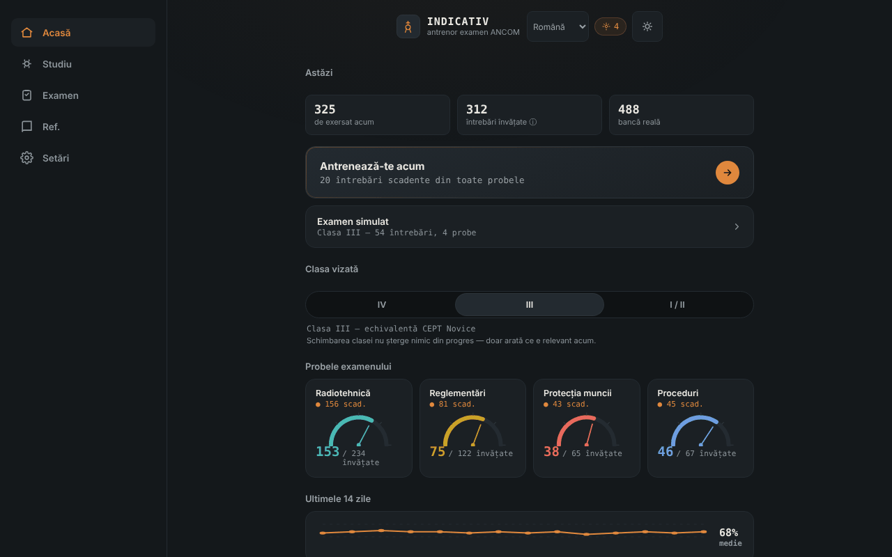

# INDICATIV — antrenor pentru examenul ANCOM de radioamator

[English](README.md) · **Română** · [Français](README.fr.md) · [Italiano](README.it.md) · [Español](README.es.md) · [Português](README.pt.md) · [Deutsch](README.de.md) · [Magyar](README.hu.md)

**Versiune:** 2.1.0 · **Ultima actualizare:** 2026-10-27

**Stare:** stabil (aplicația); conținut nevalidat oficial ANCOM · **Offline:** complet (fără cereri de rețea; linkurile mailto/ETER se deschid doar la click)

Limbile interfeței: **Română, English, Français, Italiano, Español, Português (PT), Deutsch, Magyar**

Antrenor offline, neoficial, pentru examenul ANCOM de radioamator: repetiție spațiată și examen simulat, într-un singur fișier HTML. Însoțitor al [ETER](https://chiuta.github.io/ETER/).

**Live:** https://chiuta.github.io/INDICATIV/

## Ce este

INDICATIV este un proiect personal de studiu pentru viitorii radioamatori din România. Conține o bancă de 723 de întrebări cu patru variante de răspuns, împărțite pe probele examenului: radiotehnică (469), reglementări (122), proceduri de operare (67) și protecția muncii (65). Aplicația reține local ce ai greșit și îți arată mai des acele întrebări.

**Aplicația nu este material oficial ANCOM**, nu este realizată sau avizată de ANCOM și nu are valoare juridică. Examenul real poate diferi (întrebări, structură, reglementări actualizate).

## Funcții

Verificate în cod și în browser:
- Antrenament cu repetiție spațiată (algoritm de tip SM-2): întrebările scadente și cele noi apar primele; cele greșite revin în aceeași rundă după câteva cartonașe. Mărimea rundei: 10, 20 sau 30 de întrebări.
- Alegerea clasei vizate (IV, III, I/II); aplicația arată probele relevante (clasa IV nu are probă de radiotehnică; la clasa III radiotehnica folosește doar întrebările de nivel A și B).
- Examen simulat cu structura probelor din Decizia ANCOM 245/2017 (număr de întrebări și prag minim pe probă), fără feedback pe parcurs, cu rezultat ADMIS/RESPINS și revizuirea greșelilor.
- „Revizuiește doar greșelile”, „Recapitulare rapidă” (reglementări + proceduri), „Sprint final”, reluarea unei runde întrerupte.
- Indicator de progres pe probă, serie de zile de studiu și graficul ultimelor 14 zile.
- Referință: alfabet fonetic (cu citire vocală, dacă browserul o oferă), coduri Q, prescurtări, raportul RST, semnale de primejdie, frecvențe de urgență (orientativ, neverificat la zi).
- Profiluri locale separate, temă automată/luminoasă/întunecată, rezumat de progres, export/import al progresului (JSON), resetare.
- „Căutare în banca de întrebări” (în ecranul Referință): caută în enunț și în variante, fără a ține cont de diacritice, și arată răspunsul corect; rezultate limitate la 30, cu mesaje pentru interogări prea scurte sau fără rezultate.
- Scurtături de tastatură în quiz: 1–4 aleg varianta, Enter/Spațiu continuă.

## Funcții noi (v2.0.0, 26 octombrie 2026)

- **Simulator de examen adaptiv**: examenul simulat păstrează structura reală a clasei alese (probe, număr de întrebări, minime), dar în modul *Adaptiv* (implicit) alege mai ales întrebările pe care le știi mai puțin, după fișele de repetiție spațiată (nevăzute, greșite, restante). Modul *Aleator* rămâne ca la examenul real.
- **Estimare de reușită**: pe ecranul examenului, o șansă orientativă de a promova toate probele la un examen cu întrebări aleatorii, pe probă, cu acoperirea băncii văzute și cele mai slabe categorii. Este un model simplificat din istoricul tău (probabilitate de reamintire din fișa SM-2, cu scădere pentru restanțe, apoi coadă binomială pe fiecare probă); **nu este o prognoză oficială**, iar banca rămâne neoficială și verificată parțial.
- Rezultatul și istoricul păstrează modul și estimarea de dinainte de examen.

## Funcții noi (v1.1.0, 14 octombrie 2026)

**Notă:** modul examen exista deja (examen simulat cu structura probelor, fără feedback pe parcurs, rezultat ADMIS/RESPINS și revizuirea greșelilor). Nu a fost dublat; am adăugat ce lipsea:

### Cronometru opțional în examenul simulat
În ecranul „Examen simulat” alegi o limită de timp: **Fără** (implicit), 30, 60 sau 90 de minute. **Durata oficială a examenului nu este stabilită în această aplicație** (nu am confirmat-o dintr-o sursă oficială), deci valoarea o alegi tu. Cronometrul (`role="timer"`) apare în bara întrebării, devine roșu în ultimele 5 minute, anunță la 10, 5 și 1 minut pentru cititoarele de ecran și se bazează pe un termen (`Date.now`), deci nu îngheață cu fila în fundal. La expirare, examenul se încheie automat: **întrebările rămase fără răspuns se numără ca greșite**, iar verdictul precizează asta. Abandonarea examenului oprește cronometrul. Alegerea se păstrează în profilul local (`settings.examMinutes`).

### Istoric al examenelor simulate
Ecranul „Examen simulat” arată ultimele 5 examene (data, clasa, ADMIS/RESPINS, „timpul a expirat”, după caz). Datele existau deja în profil (`examLog`); acum sunt vizibile. Exportul/importul de progres le păstrează.

### Transparență și copie de siguranță (fff-kit)

Un clic (sau Enter) pe versiunea afișată (`v 1.1.0 · 2026-10-14`) deschide fereastra „Transparență”: gazdele de rețea declarate (0 cereri externe), cheile de stocare locală cu dimensiuni, API-urile folosite, mărimea și SHA-256 al fișierului (cu verificator pentru un fișier descărcat) și **copia de siguranță** a datelor aplicației într-un fișier `.fff.json` (opțional criptat cu parolă, AES-GCM 256 / PBKDF2; parola nu poate fi recuperată), import cu confirmare și ștergerea datelor aplicației. Kitul (`fff-kit`, module: core, label, bundle) este lipit în `index.html`, nu face cereri de rețea și nu schimbă datele existente; fără el aplicația funcționează la fel. Copia de siguranță a kitului cuprinde cheile `localStorage` ale profilurilor INDICATIV (progres, setări, istoric); exportul propriu al aplicației („Setări” → export progres) rămâne disponibil. Textele kitului sunt în 8 limbi (ro, en, fr, it, es, pt, hu, de); **traducerile fr/it/es/pt/hu/de sunt automate și neverificate nativ**. Interfața aplicației însăși rămâne în română.

## Manual de utilizare

1. Deschide pagina și citește mesajul de întâmpinare.
2. Pe ecranul „Acasă” alege clasa vizată (IV, III sau I/II).
3. Apasă „Antrenează-te acum” sau alege o probă din „Studiu”.
4. Răspunde la întrebări; după fiecare răspuns apasă „Continuă”.
5. Din „Examen” pornești o simulare completă pentru clasa aleasă.
6. În „Setări” exporți progresul (fișier JSON) ca rezervă și îl poți importa ulterior.

## Confidențialitate și rețea

- **Stocare:** progresul (repetiții, statistici, setări, profiluri) se salvează în `localStorage` al browserului, doar pe dispozitivul tău, cu tratarea erorilor (dacă stocarea e blocată, aplicația merge fără salvare). Nu folosește cookie-uri, `sessionStorage` sau IndexedDB.
- **Rețea:** aplicația nu face niciun apel de rețea (fără `fetch`, fără resurse externe, fără gazde externe). Pagina are o politică CSP restrictivă (`default-src 'none'`). Singurul link este un `mailto:` către autor, care se deschide doar dacă îl apeși.
- **Permisiuni:** nu cere permisiuni (nici microfon, nici locație, nici cameră). Citirea vocală a alfabetului fonetic folosește sinteza vocală a browserului/sistemului; la unele browsere vocile pot fi furnizate online de producătorul browserului, în afara controlului aplicației.
- Exportul progresului este un fișier descărcat local; importul citește un fișier ales de tine și îl validează înainte de a-l folosi.

## Limite și avertismente

- **Traduceri ale întrebărilor (v1.3.1):** toate cele 723 de întrebări (enunț și 4 variante) sunt disponibile și în en, fr, it, es, pt, de, hu, afișate sub textul oficial românesc (comutator în Setări; căutarea le cuprinde și pe ele). Textul românesc rămâne textul oficial al examenului; traducerile sunt un **ajutor la învățare**, automate, neverificate de vorbitori nativi și marcate în aplicație ca neoficiale. Conținutul de reglementări (Decizia ANCOM 245/2017, proceduri) și întrebările de protecția muncii / prim ajutor (de ex. electrocutarea) sunt traduceri fidele, fără sfaturi adăugate, și **necesită revizie de specialitate sau juridică**.
- **Neoficial:** nu este un material ANCOM; textele oficiale în vigoare se găsesc la ANCOM (ancom.ro, secțiunea Radioamatori). Decizia ANCOM 245/2017 (text consolidat la 31.03.2022, modificată prin Decizia 139/2022) este baza reglementărilor, conform paginii ANCOM consultate în octombrie 2026.
- **Banca de întrebări:** a fost verificată parțial. Răspunsurile numerice de radiotehnică (peste 150 de întrebări) au fost recalculate cu un script și nu s-au găsit răspunsuri greșite; restul întrebărilor (conceptuale, de reglementări, proceduri, protecția muncii) nu au fost confirmate individual. Unele răspunsuri reflectă formularea din materialul de studiu și pot fi depășite (de exemplu culorile conductoarelor de fază, benzile exacte de 70 cm, perioada de păstrare a jurnalului). Dacă găsești o greșeală, scrie autorului (codul întrebării apare în eticheta de deasupra ei).
- **Proveniență și drepturi asupra întrebărilor:** capitolele I–III de radiotehnică provin, după autor, din „Lista de subiecte” publicată de ANCOM; capitolele IV–IX din surse comunitare (proiectul SimEx), pentru care autorul menționează licența GNU GPL; restul din materiale de studiu atribuite ANCOM Iași și comunității radioamatorilor. Statutul juridic al acestor texte nu a fost clarificat; de aceea repository-ul nu declară o licență pentru conținut (vezi mai jos).
- Variantele de răspuns nu sunt amestecate (ordinea din materialul oficial e păstrată), fiindcă unele întrebări se referă la „răspunsurile precedente”.
- Simularea de examen este didactică: rezultatul ADMIS/RESPINS nu anticipează rezultatul la examenul real.
- Telegrafia nu este o probă în structura examenului din decizie și nu este antrenată aici.

## Rulare locală / offline

Descarcă `index.html` și deschide-l în browser; funcționează complet fără internet.

## Stare și noutăți 2.1.0 (2026-10-27)

- **Stare conținut: nevalidat oficial ANCOM.** Banca de 723 de întrebări nu este validată sau avizată de ANCOM; afirmația se vede acum și în aplicație (ecranul Acasă). **Procentul de întrebări verificate nu a fost stabilit și nu este afirmat.** Singurul fapt susținut de autor: răspunsurile numerice de radiotehnică (peste 150 din 723) au fost recalculate cu un script.
- **Buton „Raportează o greșeală”** la fiecare întrebare (antrenament și examen): deschide clientul tău de e-mail cu un mesaj către alexio@trom.tf, precompletat cu codul întrebării și enunțul. **Nu se trimite nimic automat** din aplicație (fără rețea, CSP neschimbat).
- **Barem ANCOM**: simularea de examen cu timp opțional exista deja. Baremul (nr. întrebări / minim per probă) a fost comparat la 2026-10-27 cu art. 14 din Decizia ANCOM 245/2017, textul inițial din M.Of. 261/2017 reprodus pe legeaz.net — valorile coincid. Decizia nu stabilește o durată a examenului; modificările ulterioare (Decizia 139/2022) și textul consolidat **nu au fost verificate** → „de verificat” pe ancom.ro. Nota apare în ecranul Examen.
- Textele noi sunt în 8 limbi; traducerile fr/it/es/pt/hu/de sunt automate, neverificate de vorbitori nativi.

## Istoric / Changelog

### 2.1.0 — 2026-10-27 (anterior: 2.0.0)

- Buton „Raportează o greșeală” (mailto), mențiune „bancă nevalidată oficial ANCOM” și notă despre barem (art. 14, Decizia 245/2017); procentul de întrebări verificate nu este afirmat.

### 1.3.9 — 2026-10-23

- Reparat: seria de zile de studiu revenea la 1 dacă studiai în prima oră după trecerea la ora de vară („ieri” era calculat ca „acum − 24 h”); acum se folosește ziua calendaristică anterioară. Test de regresie nou.

### 1.3.8 — 2026-10-23

- Dialoguri: casetele native `alert`/`confirm`/`prompt` au fost înlocuite cu dialoguri `FFF.dialog` accesibile și traduse (tastatură, capcană de focus, Escape), cu același comportament (fff-kit 1.2.0).

### 1.3.6 — 2026-10-22

fff-kit 1.1.4: ținte tactile și text minim. Ținte tactile/text corectate în aplicație.

### 1.3.5 — 2026-10-22

fff-kit 1.1.2: PBKDF2 600 000 iterații, protecție anti-clickjacking.
### 1.3.4 — 2026-10-22
- Offline: s-au adăugat un service worker real și un manifest de aplicație web cu pictograme (instalabil; antrenorul se deschide fără conexiune după prima vizită). Vechiul manifest inline de tip data: a fost eliminat.
- Mesajele blocante `alert()` de la importul progresului și `prompt()`-ul browserului pentru adăugarea unui profil au fost înlocuite cu o notificare nemodală și un dialog în aplicație (traduse în cele 8 limbi).

### 1.3.3 — 2026-10-22
- Șabloanele ascunse „0 din 0 corecte” și „Ai promovat toate probele” sunt acum în dicționarul de limbă (8 limbi).

### 1.3.2 — 2026-10-22
- Corecție de traducere: bannerul de reluare, subetichetele de antrenament și revizuire și butonul „Revizuiește greșitele” din examen urmează acum limba interfeței.

- 1.3.1 — 2026-10-19: ajutor de traducere pentru întreg banca de întrebări (723 de întrebări) în 7 limbi, afișat sub textul oficial românesc; sunt traduse și categoriile, materiile și cele 19 indicii de formule.
- 1.2.0 — 2026-10-19: după răspuns, în antrenament, link „citește în ETER” (filă nouă) spre secțiunea care acoperă subiectul întrebării (~136 din 723 de întrebări); link spre Alfabete la referința fonetică. Doar legături, fără cereri de rețea.
- 1.1.0 — 2026-10-14: cronometru opțional în examenul simulat (cu închidere automată și întrebări rămase numărate ca greșite); istoric al ultimelor 5 examene; kit fff-kit (Transparență + copie de siguranță). Banca de întrebări nu s-a schimbat.

- 1.0.0 — 2026-10-12: versiunea și data ultimei actualizări sunt afișate în aplicație
- Formulele afișate după răspuns în antrenament acoperă acum 100 din cele 216 întrebări numerice de radiotehnică (față de 29): rezistențe în serie și în paralel, bec cu rezistență serie, inductanță pe tor de ferită (AL), lățime de bandă și indice de modulație NBFM, putere pe sarcină, raport de câștig dBd, prefixe SI și frecvență–perioadă. Fiecare familie a fost verificată numeric cu un script față de răspunsul corect al tuturor întrebărilor potrivite (56 de întrebări calculabile, 0 neconcordanțe).
- După fiecare răspuns în antrenament se afișează acum răspunsul corect, subiectul întrebării și, când există, formula utilă (nu doar „Corect.”). Explicații individuale pentru toate cele 723 de întrebări nu există încă în bancă.
- Adăugată căutarea în banca de întrebări (Referință); titlul aplicației este acum `<h1>`, iar ecranul Referință folosește ierarhie de titluri corectă; stil de tipărire (fără bara de navigare); CSP: `script-src` pe hash SHA-256, fără `'unsafe-inline'`.
- Diacriticele cu sedilă (ş, ţ) din interfață și din bancă au fost înlocuite cu forma corectă cu virgulă (ș, ț).
- Bara de navigare de pe mobil urmează acum tema (era mereu închisă la culoare, cu contrast insuficient în tema luminoasă).
- Structură semantică (`header`, `main`, `nav`) pentru accesibilitate; axe-core: 0 violări la 1280 și 360 px.
- Reglementările nu au putut fi reverificate independent la 11.10.2026; textul din „Limite și avertismente” rămâne cel din octombrie 2026, cu trimitere la ANCOM.

## Licență

Licența nu este încă declarată. Din cauza proveniunii întrebărilor (inclusiv materiale comunitare menționate sub GNU GPL), alegerea unei licențe pentru conținut depinde de clarificarea drepturilor.

## Autor

Alexio — Alexandru-Ionuț Chiuță, contact: alexio@trom.tf

## Rezumat

INDICATIV este un antrenor neoficial, offline, într-un singur fișier (în română) pentru examenul de radioamator ANCOM: 723 de întrebări cu variante multiple, repetiție spațiată SM-2 și un examen simulat după structura din Decizia ANCOM 245/2017. Progresul se stochează doar în `localStorage` al browserului; aplicația nu face cereri de rețea (CSP strict). Nu este material oficial ANCOM; licențierea textelor întrebărilor este nerezolvată, deci nu este declarată încă nicio licență.
